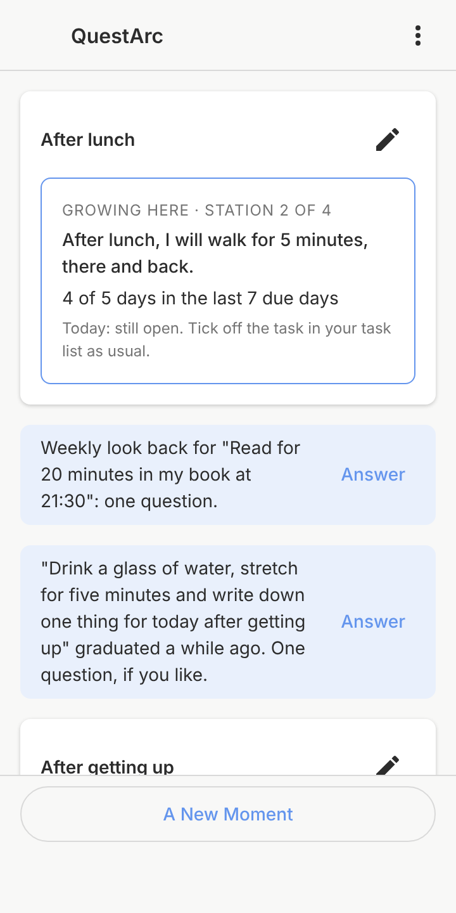
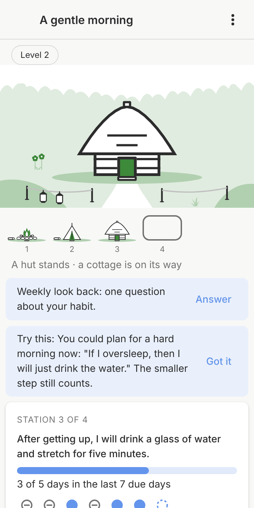
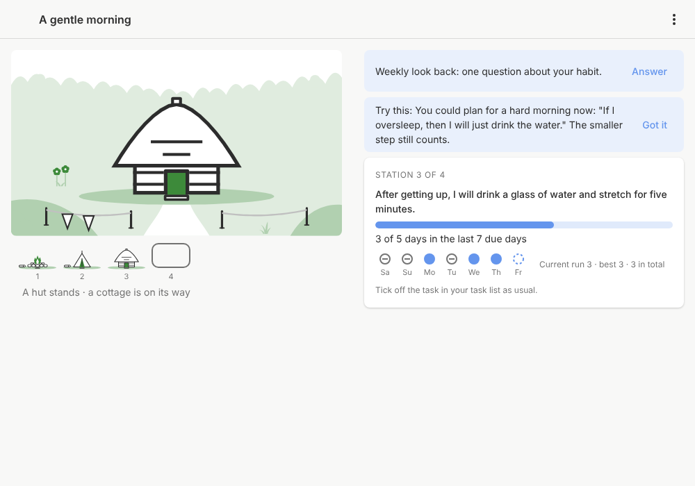

# QuestArc

Habits as journeys: QuestArc turns the habits you build in
[Super Productivity](https://super-productivity.com) into a journey of
small steps, and every journey builds something that grows with you.
Calm, without points or levels.

QuestArc runs in two places with the same game and the same data:

- as a plugin for Super Productivity (available now);
- inside [Pensum](https://github.com/nexumia-de/pensum), a native app for
  Linux phones (Phosh) on Super Productivity's data (planned).

  

_Screenshots from demo data._

## What it does

- **Your moments, not a list of habits.** You name a moment that
  already exists in your day ("after getting up", "at 21:30"), and a
  journey adds one small step to it ("After getting up, I will drink a
  glass of water"). One step grows at a time. What has become a habit
  stands at its moment and is no longer ticked off, so the list gets
  shorter, not longer.
- **Your tasks stay yours.** A station is a normal recurring task in
  Super Productivity. You tick it off as usual; QuestArc computes the
  journey from your tasks and never writes into titles, notes or
  projects.
- **Missed days are neutral.** A gap is grey, never red. A hard week
  offers the earlier, smaller step; you can pause a journey at any time.
  After a long break, one calm card lets you carry on, call it a pause,
  or start smaller, and what you built stays.
- **At your pace.** A reached station offers to continue or to stay a
  while; a step you already do can be passed.
- **Every journey builds something.** One thing that is whole at every
  station and grows with the next, a fireplace that becomes a house. It
  follows fixed rules and shows only real progress; there are no points,
  levels or opponents.
- **Six journeys to start with:** a gentle morning, first things first
  at work, an evening wind-down, tidying a little, a walk after lunch and
  a few pages before sleep. Others can add journeys by pull request.
- **English and German**, following Super Productivity's language.
- **No network, no telemetry.** Everything stays in Super Productivity.

Why it works this way: [How QuestArc motivates you](docs/psychology.md).

## Install

QuestArc 3.0 needs Super Productivity **19.3.0 or newer** (desktop app or
the web app).

1. Download `questarc-<version>.zip` from the
   [latest release](https://github.com/nexumia-de/quest-arc/releases/latest).
   `SHA256SUMS` next to it holds the checksum.
2. In Super Productivity open **Settings**, the **Plugins** tab (puzzle
   icon), and upload the ZIP; confirm **Install Plugin**.
3. Switch QuestArc on in the list of uploaded plugins. Uploaded plugins
   start switched off.
4. Open **QuestArc** in the sidebar, choose a journey and start it.

To update, upload the newer ZIP the same way; QuestArc stays switched on
and your journey stays. Do not **Remove** the plugin first: that deletes
QuestArc's data (your journeys, accepted stages and answers) on all your
devices. Your tasks are never deleted.

The "QuestArc" entry in Super Productivity's in-app list of community
plugins is still the old 2.x; install 3.0 from the release ZIP.

### Coming from QuestArc 2.x

3.0 is a new start and does not read 2.x quests. Remove the 2.x plugin
before you install 3.0. 2.x wrote its state into task titles and notes;
those texts stay in your tasks until you edit them. 2.x is no longer
maintained; its code is in the git history (commit `8ec9137`).

Changes per version: [CHANGELOG](CHANGELOG.md).

## Write a journey

Anyone can write a journey, alone or with an AI agent, and publish it for
everyone by pull request: one file in `content/journeys/`, checked by CI
against the design rules, merged by the owner. Your name is shown in the
app as "Written by …". Guide: [Writing a journey](docs/authoring-journeys.md).

## Documents

- [Roadmap](docs/roadmap.md): goals, their order and the releases.
- [Architecture](docs/architecture.md): one engine, two hosts, decisions.
- [Psychology](docs/psychology.md): what helps people build habits, and
  the design rules that follow.
- [Super Productivity facts](docs/super-productivity-facts.md): the plugin
  API and data QuestArc relies on.
- [All documents](docs/index.md).

## Development

```sh
npm ci
npm run check
```

Details in [development](docs/development.md).

Work items are [issues](https://github.com/nexumia-de/quest-arc/issues) in
[milestones](https://github.com/nexumia-de/quest-arc/milestones).

## Licence

QuestArc is free software under the GNU Affero General Public License,
version 3 or later ([LICENSE](LICENSE)), © 2026 suitably. Super
Productivity's plugin API types (`@super-productivity/plugin-api`, MIT)
are a development dependency and not part of the plugin. Journeys in `content/journeys/` and `content/examples/`
are under [CC BY-SA 4.0](content/LICENSE); their authors are named in
each file (`author`) or are the QuestArc project. The pictures in
`content/art/` are the QuestArc project's own work under the same
licence.
