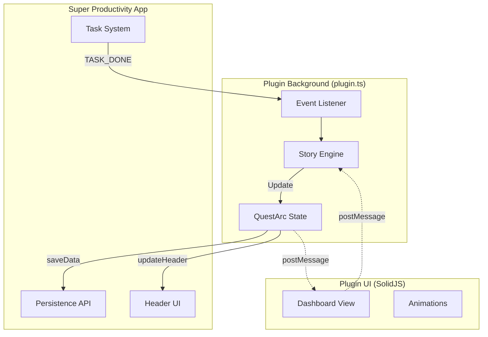

# System Architecture

## The Split-Brain Pattern

## Critical Data Paths

1. **Persistence:** `State` -> JSON -> `Storage`
2. **Visualization:** `State` -> `Header` (Mobile/Always Visible)
3. **Interaction:** `View` -> `Brain` (e.g., Claim Reward)