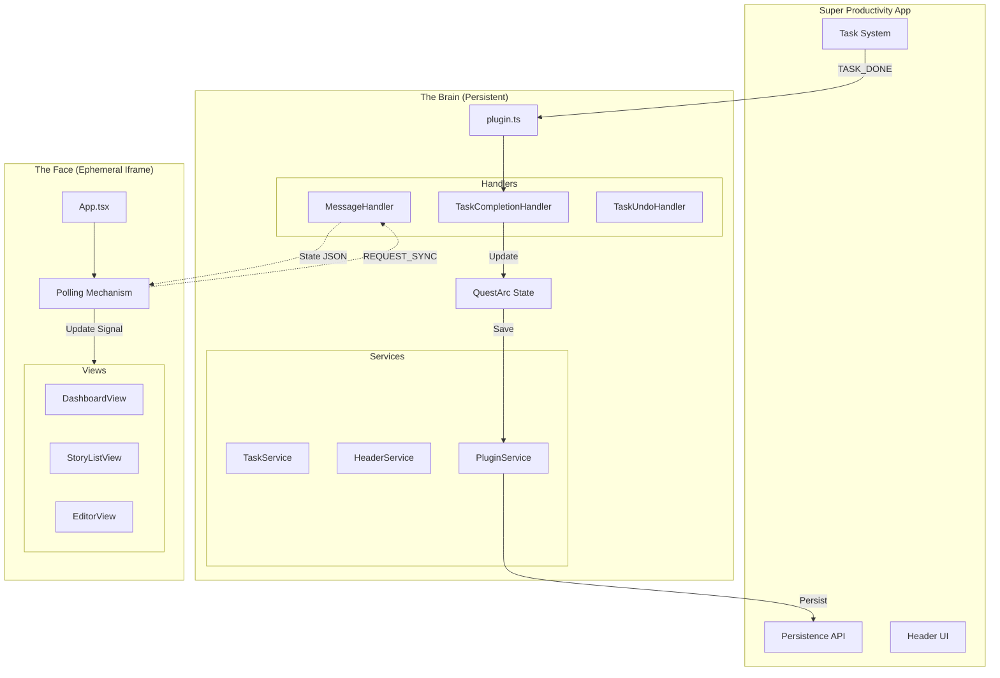

# System Architecture

## The Split-Brain Pattern

QuestArc's specific constraints (running as both a persistent background script and an ephemeral UI iframe) dictate this architecture.

## Core Components

### 1. The Brain (`src/plugin.ts`, `src/lib/`)

- **Role**: Source of Truth. Maintains state.
- **Components**:
  - `plugin.ts`: Entry point. Hooks into Super Productivity.
  - `game-logic.ts`: Orchestrator for game rules (XP, Damage, Level Up).
  - **Logic Modules** (`src/lib/logic/`):
    - `XpLogic.ts`: XP calculation tables and level curves.
    - `BossLogic.ts`: Boss initialization and scaling.
    - `StreakLogic.ts`: Habit/Grind strictness and cooldowns.
  - **Parsers** (`src/lib/parsers/`):
    - `NoteParser.ts`: Stateless extraction of JSON/Tag data from notes.
  - **Validators** (`src/lib/validators/`):
    - `TaskValidators.ts`: Guard logic for Boss/Quest completion prevention.
  - `QuestManagerService`: Manages Quest/Story progression.
  - `PluginService`: Wraps the raw `PluginAPI` for easier testing/mocking.
  - `TaskService`: Handles task creation/updates in the host app.
  - `HeaderService`: Manages the header button UI.
- **Handlers:** Event processors.
  - `TaskCompletionHandler`: Reacts to `TASK_DONE` hooks. Calculates XP/Damage.
  - `TaskUndoHandler`: Reacts to task un-completion. Reverts XP/Damage.
  - `MessageHandler`: Router for all incoming `postMessage` calls from the UI.
- **State:** The in-memory `QuestArcState` object.

### 2. The Face (`src/app/App.tsx`)

The view layer. Dumb and ephemeral.

- **Polling:** Since the Brain cannot "push" to the iframe efficiently (or reliably if the iframe is reloading), the UI polls for state every 2 seconds via `REQUEST_SYNC`.
- **Commands:** User actions (e.g., "Start Quest") are sent as messages to the Brain. The UI _optimistically_ updates if possible, but ultimately relies on the next Sync to confirm truth.
- **Routing:** Simple conditional rendering (Dashboard vs Story List vs Editor) managed by internal UI state.

## Data Flow Scenarios

### Scenario A: User Completes a Task (Background)

1.  User clicks checkmark in Super Productivity (outside our iframe).
2.  Host fires `taskComplete` hook.
3.  `plugin.ts` receives hook -> Calls `TaskCompletionHandler.handle()`.
4.  Handler:
    - Checks if an active Quest exists.
    - Calculates damage to Boss.
    - Updates `state.activeStory`.
    - Calls `saveState()`.
5.  `saveState()` notifies `BroadcastChannel` (if UI happens to be open).

### Scenario B: User Starts a Quest (UI)

1.  User clicks "Start" in `StoryListView`.
2.  UI sends `START_QUEST` message to Brain.
3.  `MessageHandler` receives message.
4.  Updates `state.activeStory` with the selected story.
5.  Calls `saveState()`.
6.  Returns updated State to UI.
7.  UI re-renders Dashboard.
