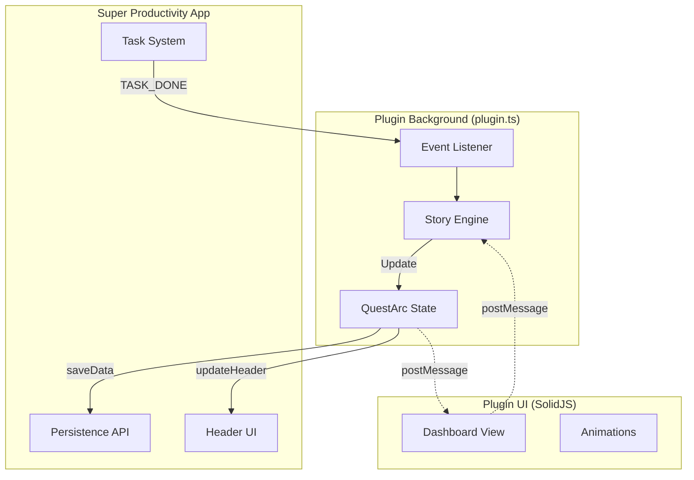

# System Architecture

## The Split-Brain Pattern

## Critical Data Paths

1. **Persistence:** `State` -> JSON -> `Storage` (via `plugin.persistDataSynced()`)
2. **Visualization:** `State` -> `Header Button` (Set once during init, cannot update dynamically)
3. **UI Polling:** `View` polls `Brain` every 2 seconds via `postMessage` (REQUEST_SYNC)
4. **Commands:** `View` -> `Brain` via `postMessage` (e.g., DEV_RESET)

## Communication Pattern

**UI to Brain:**
- UI sends `postMessage` to `window.parent`
- Brain receives via `plugin.onMessage()` handler
- Brain returns response

**Brain to UI:**
- Brain CANNOT push updates to UI
- UI must poll for state changes every 2 seconds
- Alternative: Brain shows notifications via `plugin.showSnack()`