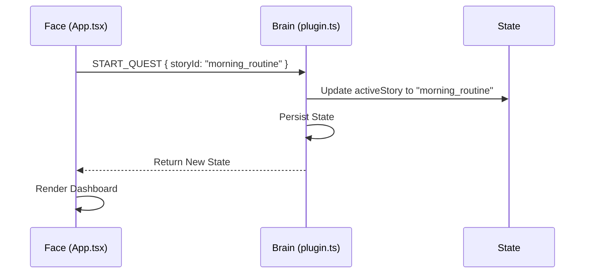
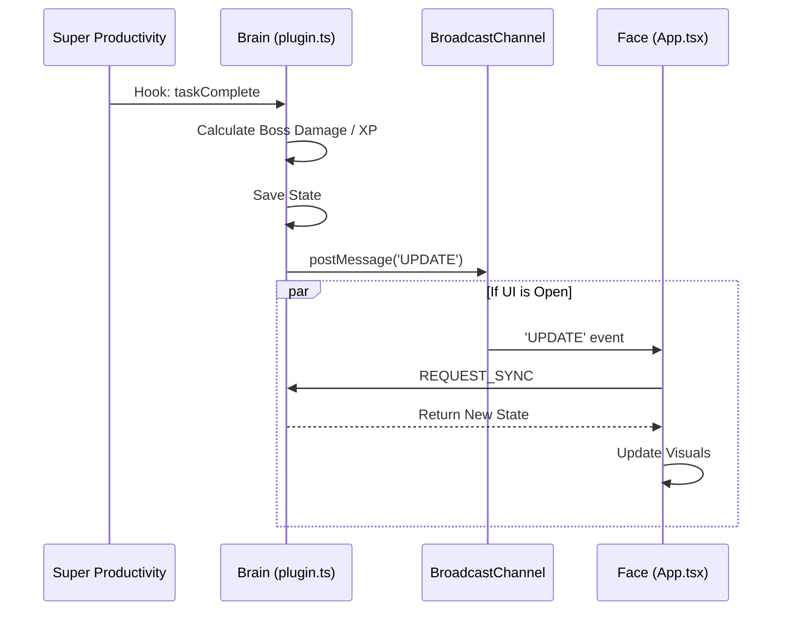

# Message Protocol

QuestArc uses `window.postMessage` and `BroadcastChannel` to communicate between the **Brain** (Persistent Plugin) and the **Face** (Ephemeral Iframe).

## Communication Flow

1.  **UI Request:** `App.tsx` sends a message to `window.parent`.
2.  **Brain Response:** `plugin.ts` relies on `PluginAPI.onMessage` to receive it and returns a response object (often the updated State).
3.  **Broadcasting:** For changes originating in the Brain (e.g., user completes a task in the host app), the Brain posts to `BroadcastChannel`. The UI listens to this channel and triggers a `REQUEST_SYNC`.

---

## Message Types

Defined in `src/types/messages.ts`.

### `REQUEST_SYNC`
**Direction:** UI -> Brain
**Purpose:** Get the latest state.
**Payload:** `null`
**Response:** `QuestArcState`

### `UPDATE_SETTINGS`
**Direction:** UI -> Brain
**Purpose:** Update global settings (custom tags, frequency aliases, streak behavior).
**Payload:**
```typescript
{
  settings: QuestArcState['settings']
}
```
**Response:** `QuestArcState`

### `SKIP_STEP`
**Direction:** UI -> Brain
**Purpose:** Force-advance to the next quest step, even if not all subtasks are complete. Stacked habits carry their current streak forward. Used when a user is stuck on a streak target.
**Payload:** `null`
**Response:** `QuestArcState` (with `activeStory` set)

### `START_QUEST`
**Direction:** UI -> Brain
**Purpose:** Begin a specific story.
**Payload:**
```typescript
{
  storyId: string;
}
```
**Response:** `QuestArcState` (with `activeStory` set)

### `ADD_STEP_TASKS`
**Direction:** UI -> Brain
**Purpose:** Manually trigger the creation of tasks for the current step (if they weren't auto-created).
**Payload:** `null`
**Response:** `QuestArcState`

### `ACKNOWLEDGE_COMPLETION`
**Direction:** UI -> Brain
**Purpose:** Close the "Quest Completed" overlay and reset/archive the active story.
**Payload:** `null`
**Response:** `QuestArcState`

### `SAVE_STORY`
**Direction:** UI -> Brain
**Purpose:** Create or Update a custom story.
**Payload:** `HeroStory`
**Response:** `QuestArcState`

### `DEV_RESET`
**Direction:** UI -> Brain
**Purpose:** Reset state to default (Development only).
**Payload:** `null`
**Response:** `QuestArcState` (Clean slate)

---

## Sequence Diagrams

### Starting a Quest



### Completing a Task (External Event)


