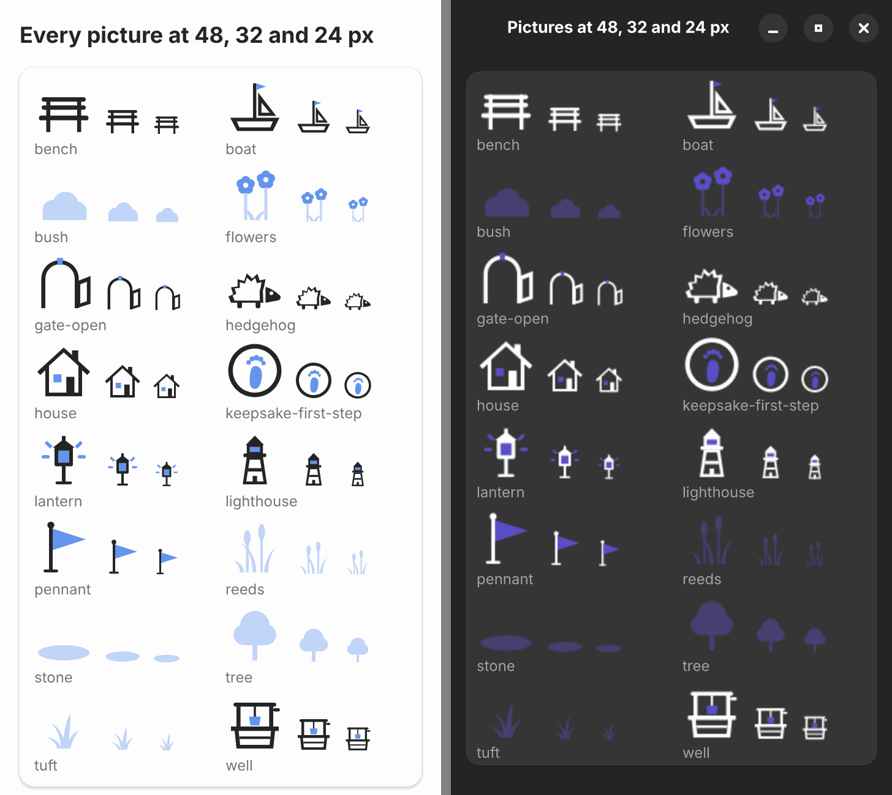

# One set of symbolic pictures for both hosts

## Question

The world (#42)[^42], keepsakes (#87)[^87] and a companion need many
pictures. Drawn twice by hand (SVG in the plugin, Cairo in Day Planner)
they would drift apart. Can one file per picture serve both hosts, in
each host's colours, light and dark (#86)[^86]?

Decided by the owner on 2026-11-12: pictures are symbolic (single shapes,
no colours of their own, filled from the host's theme), all drawn for
QuestArc (no third-party libraries or assets, one style, nothing to
attribute), journeys pick pictures by name, and there is no import of own
pictures.

## Decision: go

One set in `content/art/`, drawn once, shown by both hosts from the same
files. A meadow at three moments, plugin left, Day Planner right, at
360 × 720 (scale 2):

| Light                                                         | Dark                                                        |
| ------------------------------------------------------------- | ----------------------------------------------------------- |
|  |  |

A second kind, a shore, in both hosts, light and dark, and every picture
at 48, 32 and 24 px (plugin light, Day Planner dark):

The two hosts draw the same shapes at the same places; only the colours
differ, as they should: the plugin uses Super Productivity's primary
colour, Day Planner its own indigo accent. The art direction of a region
(depth bands, where things stand, the path, the smallest sizes) is in
[journey design](../journey-design.md#scenes-of-a-region-for-the-valley-42).

## The files

- `content/art/<name>.svg`, one picture each, own work under CC BY-SA 4.0
  like the journeys (`content/LICENSE`). Names are lower-case words joined
  by hyphens; journeys will refer to them by name.
- View box `0 0 32 32`, or `0 0 320 120` for a ground (`ground-…`), the
  size of a region's scene, `0 0 320 180` for a ladder's setting
  (`setting-…`) and `0 0 120 80` for a version of a build or the scaffold
  (`build-…`, larger than an icon: the build is the subject of the journey
  screen). Drawn on a 32 grid with the ground line at
  y = 30, so pictures stand on the ground when placed.
- Only `<svg xmlns viewBox>`, one `<title>` first (the picture's name in
  words, at most 80 characters: the accessible label), then the shapes
  `path` (`d`, `fill-rule`), `circle`, `ellipse`, `rect`, `polygon` with
  their geometry. No groups, `use`, ids, styles, colours, strokes,
  opacity, transforms, text, fonts, images, links, scripts, event
  handlers, entities other than the five XML ones, DOCTYPE or CDATA.
- Every shape has exactly one class, its colour role:

  | Role          | Colour                             | Used for                                  |
  | ------------- | ---------------------------------- | ----------------------------------------- |
  | `fg`          | text colour                        | outlines of built things, doors, the pole |
  | `accent`      | accent colour                      | one detail: window, light, flag, blossoms |
  | `dim`         | text colour, 30 % into the surface | the scaffold (behind a build); keepsakes  |
  | `bg`          | the surface itself (card colour)   | fill inside outlines, the path, waves     |
  | `tint`        | accent, 16 % into the surface      | ground, far band                          |
  | `tint-strong` | accent, 40 % into the surface      | growth, stones, water, near banks         |

  Details are cut out (`fill-rule="evenodd"`) or laid on top in another
  role, never drawn with strokes. An outline is a shape in `fg` with the
  same shape 2 units smaller in `bg` on top.

- At most 4096 bytes per file; the set's 18 pictures are 164–1046 bytes,
  the two grounds 1.4 and 1.6 KB, 20 KB with the four scenes.
- A scene is `content/art/<name>.scene.json`: its title in words, its
  size (always 320 × 120) and the pictures at fixed places (`art`,
  `band`, `x`, `y`, `width`, `height`). The ground comes first and fills
  the scene; every other picture has a `band` (`far`, `middle`, `near`),
  is square at one of the band's sizes, has its feet inside the band and
  is listed back to front. The rules are in
  [journey design](../journey-design.md#scenes-of-a-region-for-the-valley-42);
  the scenes are a meadow at three moments and a shore.

The picture checker (`packages/engine/src/art-check.ts`, `artProblems`;
scenes in `art-scene-check.ts`, `sceneProblems`) enforces these rules
with its own small XML reader,
so it stays pure and runs wherever the engine runs. CI runs it on every
file in `content/art/` (`packages/engine/test/art.test.ts`, part of
`npm run journeys`); `art-check.test.ts` shows that a file with a colour,
a stroke, a style, a script, an event handler, a link, an image, text, a
`use`, an id, a group, an unknown role or two roles, another view box,
no title, a DOCTYPE or too many bytes fails; `art-scene-check.test.ts`
does the same for a scene without its ground first, a picture without a
band, at a size or a height of another band, too far outside or out of
order.

## Ladders and a hue per region (#42)

The owner replaced the landmarks beside a path with **builds**: one thing
per journey, whole at every stage, in five versions (a **ladder**), with a
scaffold behind it while the next version is worked on and a flag on the
scaffold when it is ready; no counting in the picture. Rules, slots and
images are in [journey design](../journey-design.md#builds-and-ladders-the-valley-42).
For the files:

- `content/art/<ladder>.ladder.json`: title, default hue, `versions`
  (`build-…` pictures with titles), `scaffold`, `ways` (way points in
  build units) and `pictures` (the setting first, then pictures and the
  slots `scaffold`, `build`, `flag`, `lantern`, `keeper`). Generated by
  `scripts/draw-ladders.mjs` with the versions, the scaffold and both
  settings. `ladderProblems` (`art-ladder-check.ts`) checks bands and
  sizes like a scene (setting bands: feet 36–80, 80–145, 145–180), the
  fixed build slot, the slot order, and with the files' text that every
  version and the setting's path have a corner at each way point
  (`art-vertices.ts`).
- `content/art/palette.json`: eight hues (meadow, water, sand, heather,
  rust, slate, moss, rose), each `#rrggbb` for light and dark style.
  `paletteProblems` (`art-palette.ts`) computes WCAG contrast against the
  hosts' cards (Super Productivity white and rgb(51, 51, 51); libadwaita
  white on #fafafb, #343437, #383838, #222226): `accent` ≥ 3 : 1,
  `tint-strong` ≥ 1.5 : 1, the host's text on `tint-strong` ≥ 3 : 1. Day
  Planner's `tests/test_art.py` computes the same against libadwaita's
  colours.
- With a hue, a scene's `accent`, `tint` and `tint-strong` come from the
  hue; `fg`, `bg` and `dim` stay the host's. Plugin: the scene's `<svg>`
  gets the class `qa-art-hue` and the hue's two values as custom
  properties; `style.css` picks one with Super Productivity's
  `--is-dark-theme` (`color-mix` with `calc(var(--is-dark-theme) * 100%)`).
  Day Planner: `art.colours(widget, card, hue)` takes the value for
  `Adw.StyleManager`'s dark state and mixes the tints from it.
- Both hosts compose a ladder's scene the same way (plugin
  `src/ui/ladder.ts` `ladderScene`, Day Planner `art.ladder_scene`), each
  with tests.

## How each host recolours

- **Plugin:** `src/ui/art.ts` parses the file with `DOMParser`, adds the
  class `qa-art` and the title as `aria-label` (role `img`), and puts it
  inline; a scene is one `<svg>` with a nested `<svg>` per picture at its
  place, a far one with the class `qa-art-far`. `style.css` fills `.fg`
  with `--text-color`, `.accent` with `--c-primary`, `.bg` with the
  surface `--bg-lighter` (cards), and `.dim`, `.tint` and `.tint-strong`
  with `color-mix(in srgb, <text or primary> <share>, <surface>)`; every
  shape in `.qa-art-far` takes `tint`. Light and dark follow the app
  because the variables do.
- **Day Planner:** `pensum/ui/journey/art.py` loads the file with
  librsvg (`Rsvg.Handle`, from the GNOME runtime) and sets a stylesheet
  with one `fill` per role before rendering into Cairo: the text colour,
  the colour of libadwaita's `.accent` class, the window or card colour,
  and the mixes as in the plugin, all made opaque. A far picture gets a
  stylesheet with every role in `tint`. The scene scales with the
  widget's width and is clipped to its own size.

`dim`, `tint` and `tint-strong` are mixed, opaque colours in both hosts
rather than the text or accent colour with transparency: with
transparency, overlapping shapes of one role (the circles of a tree, the
petals of a flower) would show darker seams. The shares are fixed and the
same in light and dark style.

## Art direction (#97)

The spike's first scene was a flat row of solid icons on one heavy grey
slab, a third of it empty sky (`valley-round-0.png`). Reviewed in five
rounds in both hosts, light and dark, against the sketch
(`docs/mockups/valley-sketch.svg`)[^97]; the rounds' screenshots are
`docs/screenshots/valley-round-<n>.png`, listed in
[journey design](../journey-design.md#scenes-of-a-region-for-the-valley-42):

1. Ground in two strengths of the accent instead of `dim` made the
   meadow light; but growth in `dim` was grey and looked dead or like
   rocks, the well (with a roof) looked like the house, and loose stones
   did not make a path.
2. The path became a `bg` ribbon in the ground with stones on it, growth
   `tint-strong`, the well a windlass well without a roof. Rim lines in
   `bg` between the layers read as further roads.
3. Landmarks moved along the path, alternating sides; the hedgehog was
   outlined (solid `fg` was the heaviest spot in the scene).
4. Without rim lines the field was calm but flat.
5. Banks in `tint-strong` in the near corners give the near layer: the
   largest growth stands on them and frames the scene.

**Outlined, not solid**: built things are outlined with a `bg` fill, as
in the sketch and as the journey path's stations; solid `fg` landmarks
were the heavy spots. That needs `bg`; `tint` and `tint-strong` are both
needed for depth (field and far band light, near banks, growth and water
stronger); a third strength was not needed.

## What did not work or needed care

- **Transparent theme colours.** Super Productivity's muted text and
  libadwaita's text colour (alpha 0.8 since 1.6) are translucent; used
  directly, overlaps show. Fixed by mixing into the surface colour.
- **The accent in Day Planner.** Since libadwaita 1.6,
  `Adw.StyleManager.get_accent_color_rgba()` returns the system accent,
  not the app's own accent from `style.css`, and the background accent is
  too dark on dark surfaces. Reading the colour of a widget with the
  class `.accent` gives the app's accent, lightened in dark style
  (GNOME 51: `#594cc4` light, `#bebcff` dark).
- **Strokes** in the first sketch (`docs/mockups/valley-sketch.svg`)
  carried colours and widths; the set uses filled shapes only, so the
  checker can forbid every paint attribute.
- **A height that follows the width** in GTK: setting the content height
  inside the `resize` handler is dropped by GTK; it is set from an idle
  callback.
- **Small sizes.** At 24 px the spike's flowers were two dots and the
  hedgehog's face almost disappeared; the flowers now have five-petal
  blossoms with a `bg` centre, the hedgehog is an outlined spiky body
  with a solid snout, the open gate an arch with an outlined leaf.

## Numbers

- Files: 164–1046 bytes per picture, 20 KB with grounds and scenes.
- Day Planner, x86_64 cloud host, measured with the spike's test scene (15 pictures): in
  1.8 ms per draw with cached handles, 3.7 ms on the first draw with
  parsing; the same with librsvg 2.58 (Ubuntu) and 2.63.2 (GNOME 51
  runtime, where the scene test also passes). Not measured on a phone.
- The plugin draws inline SVG; no measurement was needed.

## Not tested here

- The plugin page in Super Productivity itself (the preview page uses the
  transcribed theme variables, `packages/plugin/preview/theme.ts`).
- Day Planner as a Flatpak: the pictures arrive with the first QuestArc
  release after 3.1.0; until then its tests are skipped with the pinned
  archive. The spike's scene test ran inside the GNOME 51 runtime with
  bubblewrap; the six-role scenes of #97 ran only with the cloud host's
  libadwaita and librsvg. There Day Planner's accent stays the darker
  indigo in dark style, so its dark screenshots show flags and blossoms
  darker than the GNOME 51 runtime would (`#bebcff`).
- The six-role scenes were judged by eye; the region palette is measured
  (above). `tint` against the card is deliberately low (about 1.1 : 1),
  it carries no information.
- `--is-dark-theme` is transcribed from Super Productivity's styles; that
  the plugin's iframe sees it was not tried in the real app.

## Consequences

- #42 and #87 pick pictures from this set by name; new pictures are drawn
  for QuestArc in the same style and pass the checker. #42 builds its
  regions on the scene rules in journey design; the meadow and shore
  scenes are examples, not the Valley's real layout (the fixed row of
  growth places, anchors from #96).
- The journey path is unchanged; the pictures are shown only on the
  preview page (`dist/preview/art.html?part=growth|shore|sizes|sequence-<ladder>|journey-<ladder>|palette`)
  and in Day Planner's demo (`tests/art_demo.py` with the same parts)
  until the world and keepsakes pages exist.
- The region scenes (meadow with landmarks, shore) are superseded as a
  design by the ladders; they stay as checker examples.
