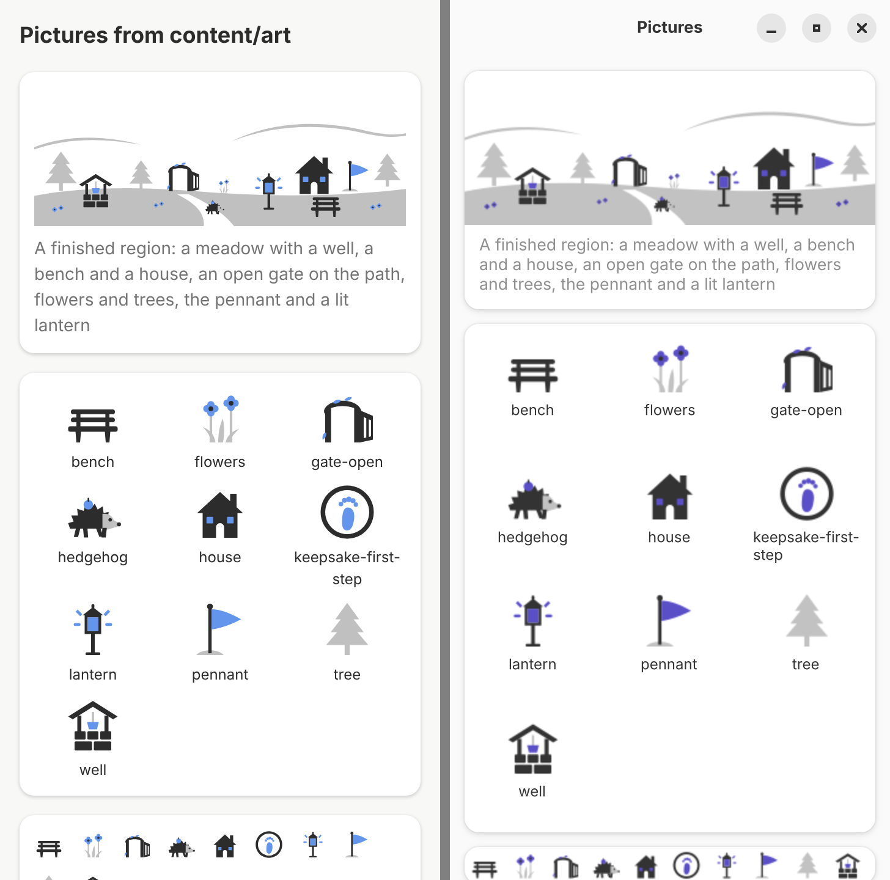
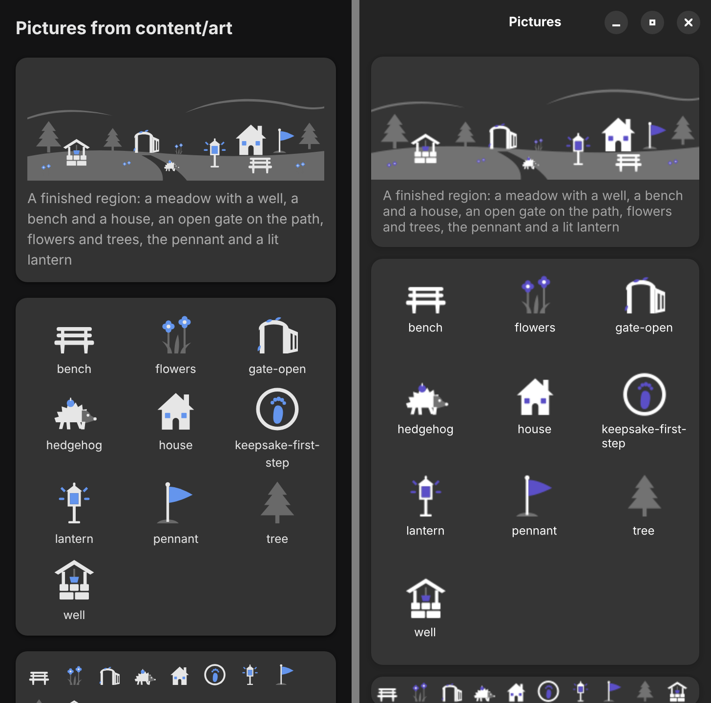
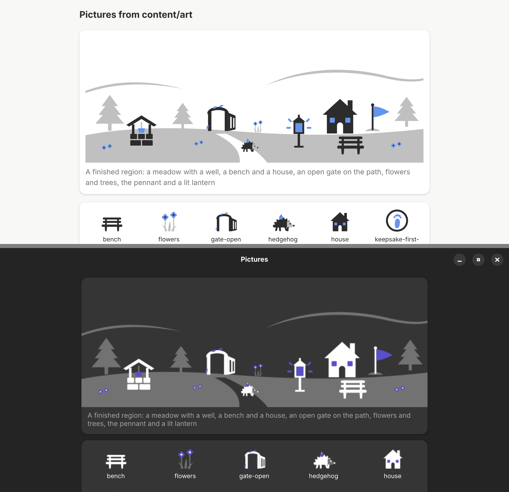

# One set of symbolic pictures for both hosts

## Question

The world (#42)[^42], keepsakes (#87)[^87] and a companion need many
pictures. Drawn twice by hand (SVG in the plugin, Cairo in Day Planner)
they would drift apart. Can one file per picture serve both hosts, in
each host's colours, light and dark (#86)[^86]?

Decided by the owner on 2026-11-12: pictures are symbolic (single shapes,
no colours of their own, filled from the host's theme), all drawn for
QuestArc (no third-party libraries or assets, one style, nothing to
attribute), journeys pick pictures by name, and there is no import of own
pictures.

## Decision: go

One set in `content/art/`, drawn once, shown by both hosts from the same
files. Screenshots of the test scene and every picture, plugin left, Day
Planner right, at 360 × 720 (scale 2):

| Light                                                         | Dark                                                        |
| ------------------------------------------------------------- | ----------------------------------------------------------- |
|  |  |

Desktop size (1000 × 700): the plugin in light style above, Day Planner in
dark style below:

The two hosts draw the same shapes at the same places; only the colours
differ, as they should: the plugin uses Super Productivity's primary
colour, Day Planner its own indigo accent.

## The files

- `content/art/<name>.svg`, one picture each, own work under CC BY-SA 4.0
  like the journeys (`content/LICENSE`). Names are lower-case words joined
  by hyphens; journeys will refer to them by name.
- View box `0 0 32 32`, or `0 0 320 120` for a ground (`ground-…`), the
  size of a region's scene. Drawn on a 32 grid with the ground line at
  y = 30, so pictures stand on the ground when placed.
- Only `<svg xmlns viewBox>`, one `<title>` first (the picture's name in
  words, at most 80 characters: the accessible label), then the shapes
  `path` (`d`, `fill-rule`), `circle`, `ellipse`, `rect`, `polygon` with
  their geometry. No groups, `use`, ids, styles, colours, strokes,
  opacity, transforms, text, fonts, images, links, scripts, event
  handlers, entities other than the five XML ones, DOCTYPE or CDATA.
- Every shape has exactly one class: `fg` (text colour), `accent`
  (accent colour) or `dim` (dimmed text colour). Details are cut out
  (`fill-rule="evenodd"`) or laid on top in another role, never drawn
  with strokes.
- At most 4096 bytes per file; the set's pictures are 324–985 bytes,
  7 KB for all eleven.
- A scene is `content/art/<name>.scene.json`: its title in words, its
  size and the pictures at fixed places (`art`, `x`, `y`, `width`,
  `height`). The test scene `spike-region` puts a ground, three landmarks
  (well, bench, house), a keeper (open gate), two growth steps (flowers,
  trees), the pennant, a lantern and a walking hedgehog together. The
  world's real layout (#42) is still to be designed.

The picture checker (`packages/engine/src/art-check.ts`, `artProblems`
and `sceneProblems`) enforces these rules with its own small XML reader,
so it stays pure and runs wherever the engine runs. CI runs it on every
file in `content/art/` (`packages/engine/test/art.test.ts`, part of
`npm run journeys`); `art-check.test.ts` shows that a file with a colour,
a stroke, a style, a script, an event handler, a link, an image, text, a
`use`, an id, a group, another class or view box, no title, a DOCTYPE or
too many bytes fails.

## How each host recolours

- **Plugin:** `src/ui/art.ts` parses the file with `DOMParser`, adds the
  class `qa-art` and the title as `aria-label` (role `img`), and puts it
  inline; a scene is one `<svg>` with a nested `<svg>` per picture at its
  place. `style.css` fills `.fg` with `--text-color`, `.accent` with
  `--c-primary` and `.dim` with
  `color-mix(in srgb, var(--text-color) 30%, var(--qa-art-surface))`,
  where the surface is `--bg-lighter` (cards). Light and dark follow the
  app because the variables do.
- **Day Planner:** `pensum/ui/journey/art.py` loads the file with
  librsvg (`Rsvg.Handle`, from the GNOME runtime) and sets a stylesheet
  `.fg{fill:…}.accent{fill:…}.dim{fill:…}` before rendering into Cairo:
  the text colour, the colour of libadwaita's `.accent` class and the
  text colour mixed 30 % into the window or card colour, all made
  opaque. The scene scales with the widget's width.

`dim` is a mixed, opaque colour in both hosts rather than the text colour
with transparency: with transparency, overlapping shapes of one role (the
tiers of a tree, the tufts of the flowers) would show darker seams.

## What did not work or needed care

- **Transparent theme colours.** Super Productivity's muted text and
  libadwaita's text colour (alpha 0.8 since 1.6) are translucent; used
  directly, overlaps show. Fixed by mixing into the surface colour.
- **The accent in Day Planner.** Since libadwaita 1.6,
  `Adw.StyleManager.get_accent_color_rgba()` returns the system accent,
  not the app's own accent from `style.css`, and the background accent is
  too dark on dark surfaces. Reading the colour of a widget with the
  class `.accent` gives the app's accent, lightened in dark style
  (GNOME 51: `#594cc4` light, `#bebcff` dark).
- **Strokes** in the first sketch (`docs/mockups/valley-sketch.svg`)
  carried colours and widths; the set uses filled shapes only, so the
  checker can forbid every paint attribute.
- **A height that follows the width** in GTK: setting the content height
  inside the `resize` handler is dropped by GTK; it is set from an idle
  callback.
- **Small sizes.** At 24 px the flowers are two dots and the hedgehog's
  face (dim) almost disappears on dim ground; in the scene the hedgehog
  walks on the path, where the surface shows through.

## Numbers

- Files: 324–985 bytes per picture, 8 KB with the scene.
- Day Planner, x86_64 cloud host: the test scene (15 pictures) in
  1.8 ms per draw with cached handles, 3.7 ms on the first draw with
  parsing; the same with librsvg 2.58 (Ubuntu) and 2.63.2 (GNOME 51
  runtime, where the scene test also passes). Not measured on a phone.
- The plugin draws inline SVG; no measurement was needed.

## Not tested here

- The plugin page in Super Productivity itself (the preview page uses the
  transcribed theme variables, `packages/plugin/preview/theme.ts`).
- Day Planner as a Flatpak: the pictures arrive with the first QuestArc
  release after 3.1.0; until then its tests are skipped with the pinned
  archive. The scene test ran inside the GNOME 51 runtime with
  bubblewrap.

## Consequences

- #42 and #87 pick pictures from this set by name; new pictures are drawn
  for QuestArc in the same style and pass the checker.
- The journey path is unchanged; the pictures are shown only on the
  preview page (`dist/preview/art.html`) and in Day Planner's demo
  (`tests/art_demo.py`) until the world and keepsakes pages exist.
