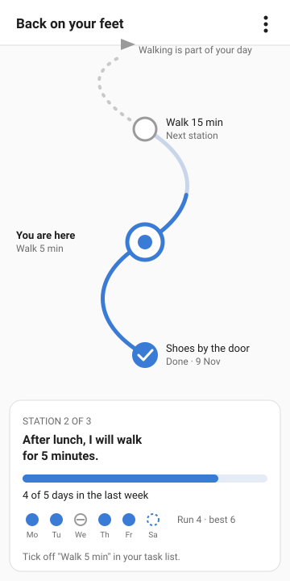
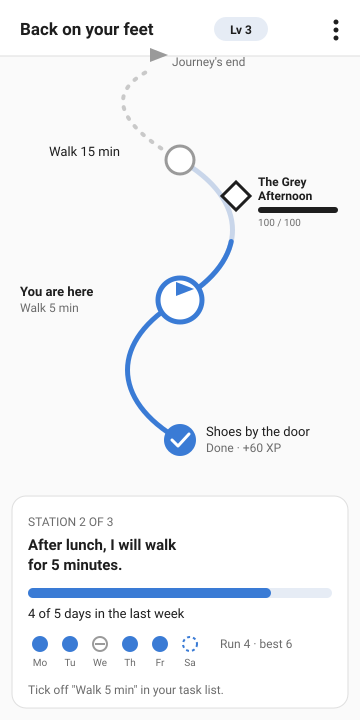
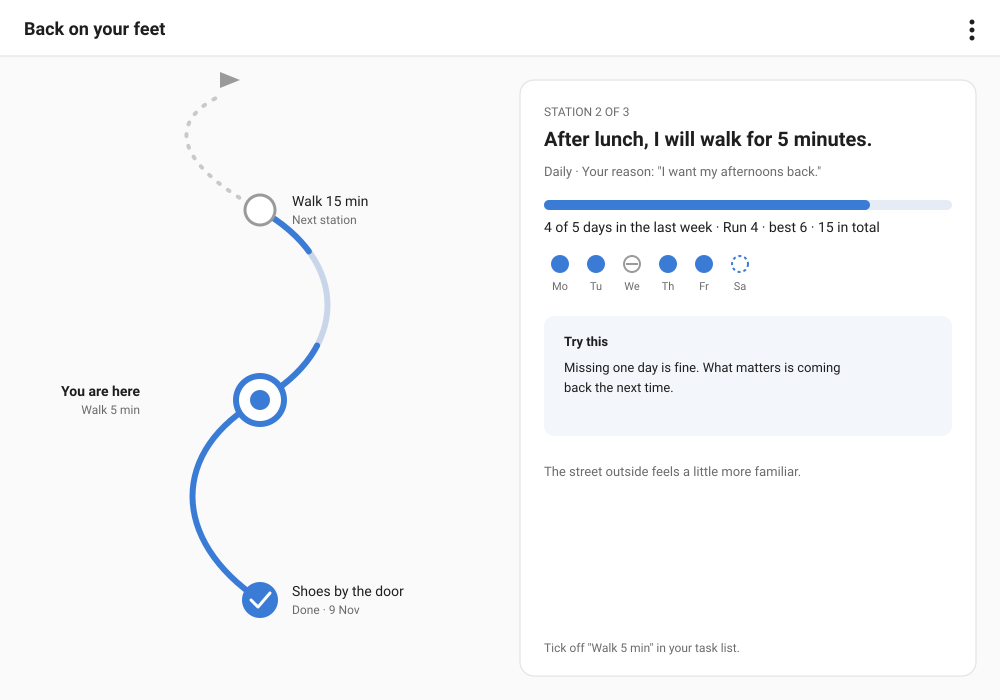
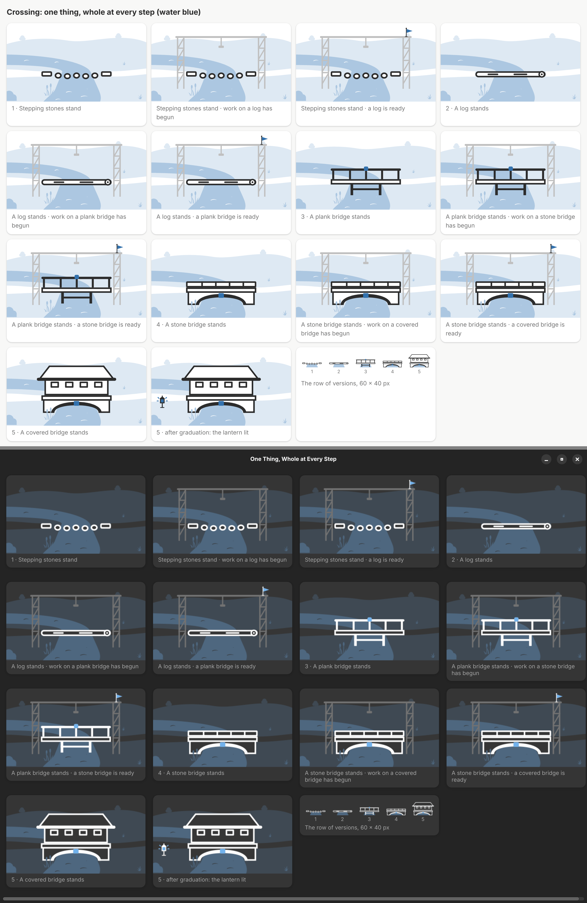
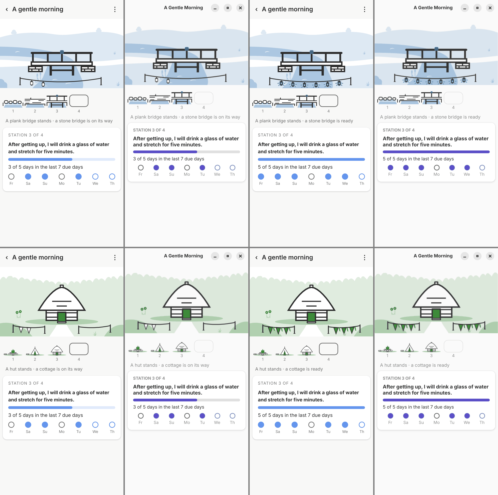
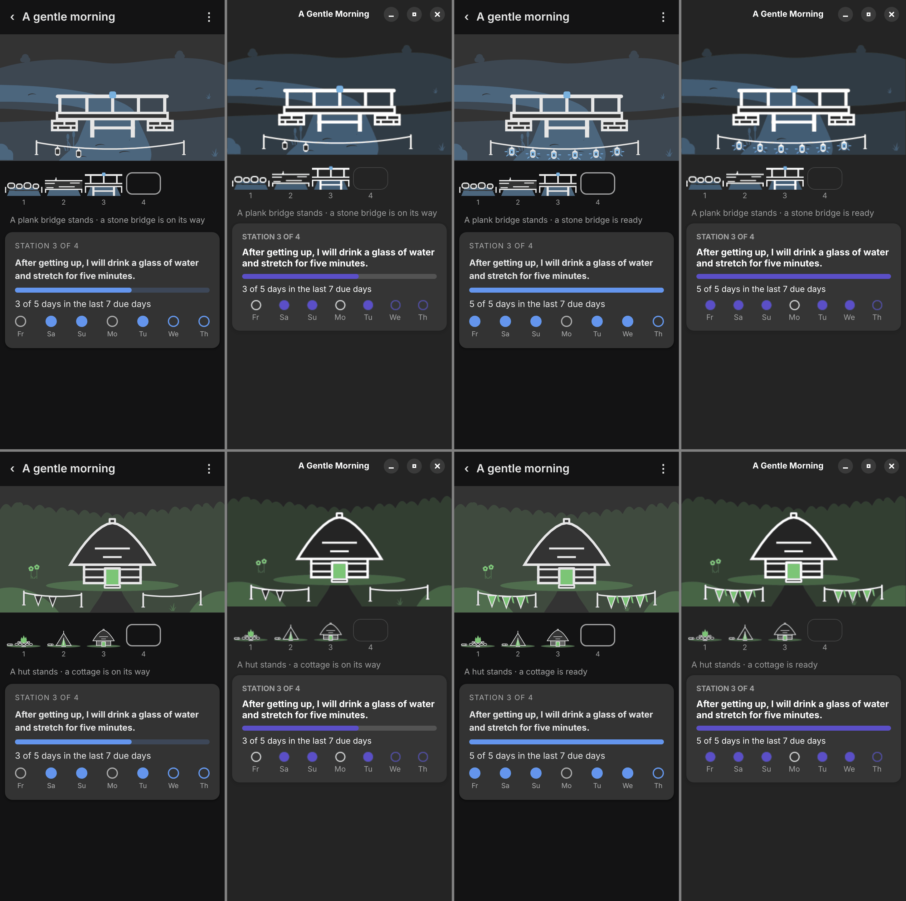
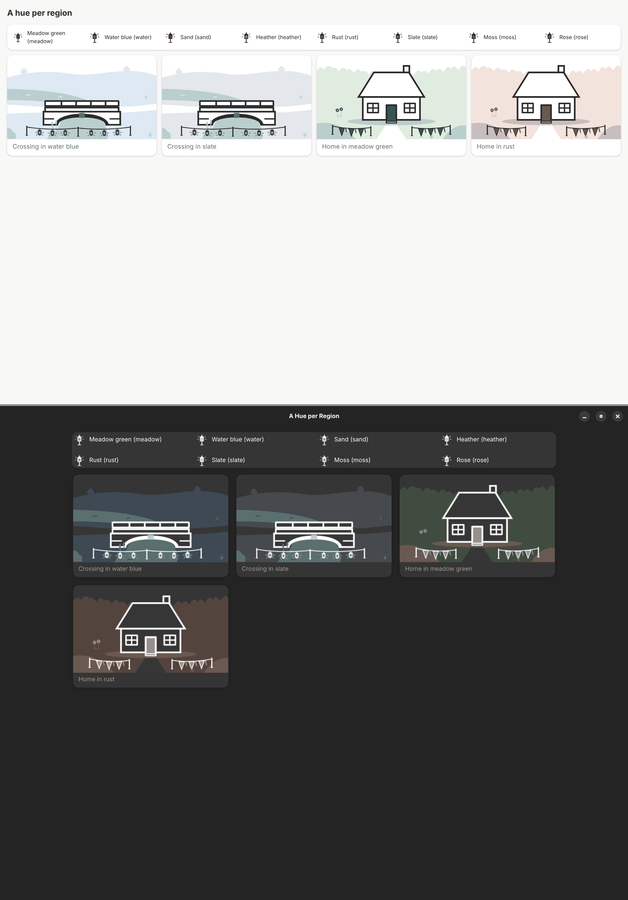
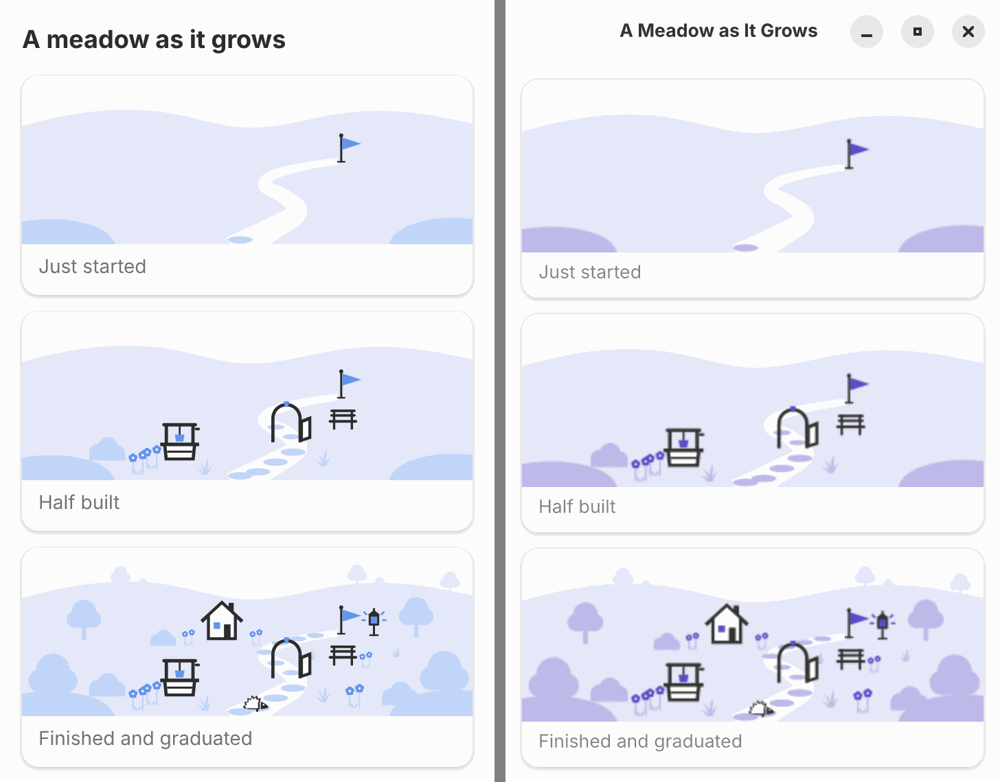
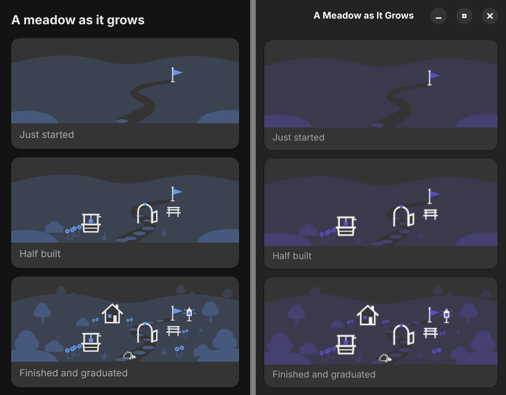
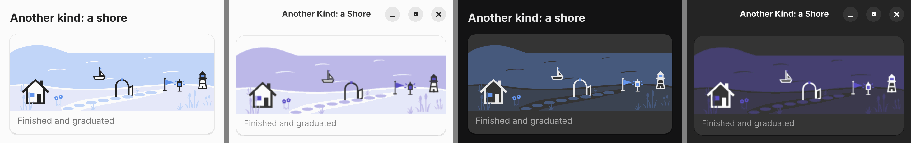

# Journey design

Decided on 2026-11-05 (#15) by best practice, as the owner asked: one
layout with a calm and a game variant, drawn from simple shapes in the
host's own colours. The screens around it are in [behaviour](behaviour.md).

## Mockups

| Phone, calm                                    | Phone, with game                                   |
| ---------------------------------------------- | -------------------------------------------------- |
|  |  |

[valley-sketch.svg](mockups/valley-sketch.svg) is a rough sketch for the
world (#42): the journey as its region and the regions as a map. It is
a sketch, not a decision; the pictures it hints at are now drawn as
symbolic files ([shared pictures](decisions/shared-pictures.md)).

The mockups use neutral placeholder colours (blue accent on light grey).
In the plugin the colours come from Super Productivity's theme variables,
in Pensum from libadwaita's accent and named colours, both in light and
dark style.

## Layout

- **Phone (360 px):** the path fills the upper part and scrolls
  vertically; the current station's card sits at the bottom with the
  plan, the condition and the last seven due days. The path opens
  scrolled so that the current station is in view.
- **Desktop and wide windows:** the path on the left, the current or
  selected station's details on the right (plan, reason, condition, last
  days, learning nugget, arrival story).
- The path runs from the bottom (start) to the top (goal), so going up
  means getting further. Finished stations scroll out below.

## Path and stations

| Element          | Shape                                                                  | Text next to it            |
| ---------------- | ---------------------------------------------------------------------- | -------------------------- |
| finished station | filled circle with a check mark                                        | short name, "Done · date"  |
| current station  | large ring; calm: a dot inside, game: a pennant (the hero)             | "You are here", short name |
| met station      | large ring with a check mark ring, button "Continue" in the card       | "Ready to continue"        |
| station ahead    | small hollow circle                                                    | short name                 |
| unbound station  | hollow circle with a small plus                                        | "Set up the task"          |
| goal             | pennant at the end of the path                                         | the ending in a few words  |
| path behind      | solid line in the accent colour                                        | —                          |
| current segment  | light line, filled in the accent colour up to the condition's progress | —                          |
| path ahead       | dotted grey line                                                       | —                          |
| guardian (game)  | diamond on the segment it guards, with name and HP bar                 | name, "HP / max"           |

- The path is a gentle S-curve with fixed geometry per station count;
  no map, no landscape art, no characters. This keeps it drawable with
  SVG in the plugin and with GTK drawing in Pensum, and it stays QuestArc's
  own look.
- The hero is a pennant, not a figure: no avatar to customise, nothing
  to collect.

## Last seven due days

A row of marks in the card, oldest left; the engine reports them as
`lastDays` of the current station ([data model](data-model.md) §3):

| Day        | Mark                                                                                   |
| ---------- | -------------------------------------------------------------------------------------- |
| done       | filled circle                                                                          |
| gap (miss) | hollow grey circle with a dash                                                         |
| open       | dashed ring (today, or yesterday not yet ticked off: still inside the backfill window) |
| not due    | not shown (only due days are listed)                                                   |
| paused     | two short bars                                                                         |

Weekday letters below each mark. A gap is grey, never red, and no count
falls to zero; the run text ("Run 4 · best 6") stays next to the marks.

## Calm and game

Same layout. The game variant adds: level chip in the header, the pennant as hero, guardians on the path and XP
earned on finished stations. XP is never shown before it is earned.

## Accessibility

- Every state has a shape and a text, not only a colour.
- Touch targets of stations at least 44 × 44 px, even when the drawn
  circle is smaller.
- Texts follow the system font size; the card grows, the path scrolls.
- Screen readers get the stations as a list in path order with their
  state ("Station 2 of 3, current: walk for 5 minutes, 4 of 5 days").

## Builds and ladders (the Valley, #42)

Decided by the owner on 2026-11-12[^42]: a journey builds **one thing**,
whole at every stage, and every stage makes it a larger version. A
**ladder** is that thing drawn once in five versions and used by every
journey that picks it. The first two ladders, Crossing (with lanterns
and with pennants) and Home (with pennants and with flowers); plugin
light above, Day Planner dark below (scale 2). Each version, then its
marker growing element by element (every element for the first stage, a
few sampled steps for the others), ready, then the next version:

The journey screen as a static mock (plugin and Day Planner side by side;
Crossing above, Home below; first mid-way, posts up and two elements
hanging, then ready), light and dark: the build on top, the row of
versions below it, the state in words, the card unchanged.

| Light                                                          | Dark                                                         |
| -------------------------------------------------------------- | ------------------------------------------------------------ |
|  |  |

**Files.** A ladder is `content/art/<ladder>.ladder.json` with its title,
the default hue, whether its setting is water (`water`), its default
marker kind (`marker`), the marker's layout and post points (`layout`,
`posts`), where its setting has water (`waterAreas`), the versions (`build-<ladder>-<n>.svg`, each with a
title), optionally the part of every version the row of versions shows
(`row`), the way points (`ways`) and the setting with its places,
including the marker's; the setting is `setting-<kind>.svg`. Checked by
`ladderProblems` (`packages/engine/src/art-ladder-check.ts`) in
`npm run journeys`. The coordinates of both ladders come from
`scripts/draw-ladders.mjs`: change the numbers there and run it, never
edit the generated files by hand.

**Rules for drawing a ladder** (a new ladder comes by pull request like a
journey):

1. **Whole at every step.** Each version is a complete thing (a log, a
   plank bridge, a hut), never half built. Five versions; each clearly
   the same thing grown: same place, same footprint centre, larger.
2. **Same place, same setting.** Every version is drawn in the build's
   view box `0 0 120 80`, standing on y = 74, centred on x = 60, and
   placed in the same build slot of the setting (210 × 140 setting units,
   1.75 per build unit, base line on y = 140). Switching versions must
   read as the thing growing, not as a new picture.
3. **The way.** A build that carries the way (a crossing) has two fixed
   way points: its walking surface runs from x = 14 to x = 106 at
   y = 57–64 in every version, and the setting's path ends exactly there
   on both banks, as thick as the surface. A build the way leads to (a
   home) has one: the threshold stone (x = 53–67, y = 74–77.5) in front
   of the fire, the tent's opening and each door, where the path ends.
   `ways` lists them; the checker requires a corner of every version and
   of the setting's path at each way point.
4. **Water runs through.** Water in a setting runs from edge to edge (the
   river leaves the near edge and bends away to the left edge behind the
   crossing); it never stops in the middle of the scene. The shore's water
   also spans the whole width.
5. **Sizes.** Outlines 2 build units (3.5 px at 360 px, 1 px in the row of
   versions); every version must read at the journey screen's size (the
   setting 360 px wide) and in the row of versions at 60 × 40 px: give the
   smallest versions mass and a clear silhouette (stones with a flat top,
   a log as thick as two path widths), not thin lines. A ladder whose
   small versions are wide and flat may name `row`, a 3 : 2 part of the
   build's view box that the row shows zoomed (Crossing: `[30, 38, 60,
40]`, the stones without the bank slabs); the scene always shows the whole build. The largest version may
   reach y = 4; the setting's sky is at most its top fifth.
6. **Bank contact.** A crossing rests on the banks at both way points:
   stone abutments under the deck ends (stepping stones, log, plank
   bridge) or masonry reaching into the banks (stone and covered bridge).
   No deck floats.
7. **Growth in size and form.** Each version is larger than the one
   before and also different in form, so the row reads as a story: Home
   is a fire in a ring of single stones, a tent, a hut under a round
   thatch, a cottage with a pitched roof and chimney, a house of two
   storeys.
8. **Look.** Outlined in `fg` with a `bg` fill, one `accent` detail (the
   flame, a glowing door or window, the keystone, a rail cap), water and
   the yard in `tint-strong` of the region's hue. The setting is quiet:
   ground and far trees in `tint`, a few reused plants (tuft, reeds, bush,
   flowers, far trees) in the bands of the region scenes.

**Markers: a stage on its way** (owner, 2026-11-12; replacing the
scaffold, which looked like a permanent building site over a thing that
is meant to be whole, and later drafts with a ring around the build and
with fixed phases, which could not be read in order). While a stage runs,
a small festive **marker** grows in the foreground, in front of the
build, never on it, behind it or across it:

- **Element by element.** A marker has E elements in a fixed order: first
  the posts, one after the other, then the hanging elements, one after
  the other along the line from the first post. The line between two
  neighbouring posts shows once both stand. The hosts show the first
  ceil(p × E) elements, p (0 … 1) the best progress reached in the
  stage's condition; p = 1 means all stand. So a `days` stage (5 of 7)
  and a `count` stage (20) fill the same marker, and since p is the best
  progress, never the current one, the marker never loses an element.
- **Ready** while the condition is met now: every hanging element takes
  its "on" form, different in shape, not only in colour: lanterns filled,
  with a flame and rays; pennants solid with a second tail; flowers open
  instead of in bud. It reads without telling the accent apart.
- **Posts carry nothing on top.** They are plain (a post with a rounded
  top); everything decorative hangs from the line.
- After the last version nothing is on its way: no marker. On Continue
  the next version stands and the marker is gone until the next stage's
  first counting completion.

Counts stay where they are exact: the progress bar, the words ("3 of 5
days") and the seven day marks in the card. Under the row of versions
the state is said in words, never as a building site: "A plank bridge
stands · a stone bridge is on its way" while the stage runs, "… · a stone
bridge is ready" while it is met.

**Marker kinds** (`content/art/markers.json`), each drawn once and used
with every ladder and setting; what hangs is the user's choice per
journey, the ladder only gives the default (`marker`: Crossing lanterns,
Home pennants):

- **lanterns**: small lanterns, outlined; ready filled with a flame, a
  halo and rays.
- **pennants** (`bunting`): pale outlined pennants; ready solid in the
  accent with a second tail.
- **flowers**: vines with closed buds; ready open blossoms. Land only:
  the checker refuses flowers for a ladder whose setting is water
  (`"water": true`).

Each kind has three pictures (view box 32 × 32): `marker-<kind>-post`
stands on y = 30 and the line is tied on at (16, 12); `marker-<kind>-bead`
hangs from the line at (16, 2); `marker-<kind>-bead-lit` is its ready
form.

**Layouts and post points.** A setting declares its marker's layout and
an ordered list of post points in the near band, as it declares where the
path meets the build:

- `span`: one continuous line over all posts (at least two). For a
  setting where the line can run in front of the build without crossing
  the way or the view: Crossing, two posts on the near ground of each
  bank and one line across the water in front of the bridge, sagging
  gently.
- `sides`: two short lines, left and right, with a gap in the middle
  (four posts, two on each side). For a way leading to the build (Home:
  the path to the door) or a build on water (a boat: the gap is the
  waterway).
- **Choosing**: the gap is wherever the user's way or view to the build
  passes. If nothing passes in front of the build, `span`; otherwise
  `sides` with the gap there.
- **No post stands in water.** A setting with water marks it
  (`waterAreas`, polygons in setting units, in the ladder file); a post
  point inside one is refused. A line may cross water; a long line is
  drawn a little thicker and sags more (by its length), it never gets an
  extra post.

The lines are pictures of the setting (`setting-<kind>-cord-<n>.svg`, the
same for every kind); the hanging elements sit at fixed points along
them, spread evenly, in order from the first post (Crossing 2 posts and 6
elements, Home 4 posts and 6 elements). All numbers come from
`MARKER_LAYOUTS` in `scripts/draw-ladders.mjs`. Every marker place in the
ladder file has its `order` (1 … E); a line has the order of its second
post.

The checker (`ladderProblems`, `markerProblems`) requires: a known marker
kind with its three pictures and a title; flowers not on water; a layout
of `span` (at least two post points) or `sides` (four); post points in
the near band, left to right, none in a marked water area; one post on each point, in order, tied on below the
build's base line; one line per pair of neighbours (`sides`: none across
the gap), each shown with its second post; at least two hanging elements
after the posts, in order, each under a line and below the build; nothing
of the marker over a way point.

**A new marker kind** comes by pull request like a ladder: add it to
`MARKERS` in `scripts/draw-ladders.mjs` with its three pictures (a plain
post, the hanging element and its ready form, different in shape), set
`landOnly` if it needs ground, run the script, and show it with every
ladder in both hosts (`sequence-<ladder>-<kind>`) light and dark at
360 px. A new setting declares its layout and post points by the rule
above.

**Slots** in a ladder's setting, filled by the hosts: `build`, `lantern`
(after graduation, lit, where the marker's first post stood: the
marker's lasting form), `keeper` (a worn-down guardian; pictures for
keepers are not drawn yet) and the `marker` places above.

**Row of versions.** Below the build: the standing versions as small
pictures (60 × 40 px), the next one as a plain outlined step without a
picture, like stations ahead; nothing further is shown.

**Colour per region.** A region's scene takes `accent`, `tint` and
`tint-strong` from one hue of `content/art/palette.json` (eight named
hues, a light and a dark value each); `fg`, `bg` and `dim` stay the
host's, and the path, card and controls keep the host's accent. The
setting's kind sets the default (river: water blue; clearing: meadow
green). Each hue is checked by computation (WCAG relative luminance) in
both repositories: `accent` at least 3 : 1 against every host card (WCAG
1.4.11, non-text), `tint-strong` at least 1.5 : 1 (decorative, but the
water must show) and the outline `fg` at least 3 : 1 on `tint-strong`;
`tint` is decorative and not tested. Each ladder in two hues, plugin
light above, Day Planner dark below:

**Review rounds** (both hosts, light and dark, journey mock at 360 × 720;
rounds 1–4 still show the dropped pile or scaffold):
[1, crossing](screenshots/ladder-round-1-crossing.png) and
[home](screenshots/ladder-round-1-home.png): the build too small, the
river a straight wedge, beams like drawers;
[2](screenshots/ladder-round-2.png): larger slot (1.75), river bends at
the near edge, hut redrawn; [3](screenshots/ladder-round-3.png): river
behind a fold, wider pile columns (the pile was later dropped);
[4](screenshots/ladder-round-4.png): the owner's corrections: the path
meets the crossing and the door at fixed way points, the river runs edge
to edge, the scaffold and flag instead of a pile. Markers (both hosts,
journey mock light): [m1](screenshots/ladder-markers-round-1.png) a ring
of posts around the build: the abutments looked like boats, too many
lanterns, the flame a tree; [m2](screenshots/ladder-markers-round-2.png)
brick abutments, a rounded thatch for the hut, the row zoomed;
[m3](screenshots/ladder-markers-round-3.png) the owner could not read the
ring's steps in order (a line behind the build looked odd, ready was a
colour only): superseded by a gate across the path, then by the marker
that grows element by element; [m4](screenshots/ladder-markers-round-4.png)
element by element, `span` and `sides`: the posts looked like
stanchions, and the scenery flowers read as a hanging element;
[m5](screenshots/ladder-markers-round-5.png) slimmer posts, larger
elements; then the owner asked for plain posts with nothing on top and
ready only on the hanging elements; [m6](screenshots/ladder-markers-round-6.png) plain posts, but the `span` middle post stood in the water: now two posts, one on each bank, and one line across: the final images above.

## Scenes of a region (for the Valley, #42)

**Superseded as a design** by [builds and ladders](#builds-and-ladders-the-valley-42):
the landmarks beside a path below were the first idea; the owner found
them "a path and a flag, then random things put down". The depth bands,
roles, the far silhouette and the reused plants, pennant and lantern stay
and are used by the ladders' settings; the meadow and shore scenes stay
as examples for the checker.

Art direction from #97[^97], for the Valley (#42)[^42] to build on: a
region is drawn as a place, not a row of icons. A scene is a file
`content/art/<name>.scene.json` (format and checker in
[shared pictures](decisions/shared-pictures.md)); the hosts only place
what it says. The examples are a meadow at three moments
(`meadow-started`, `meadow-half`, `meadow-finished`) and a shore
(`shore-finished`):

| Light                                                              | Dark                                                           |
| ------------------------------------------------------------------ | -------------------------------------------------------------- |
|  |  |

**Look.** Calm and light, like the [sketch](mockups/valley-sketch.svg):
built things (landmarks, keeper, lantern, pennant, boat) are outlined in
`fg` and filled with `bg`, with at most one `accent` detail (a window, the
bucket, the light, the flag); nothing built is solid. Growth (tufts,
flowers, bushes, trees, reeds) is solid `tint-strong`, with `accent` only
for blossoms. The hedgehog is outlined like a built thing. Ground and
distance use `tint` and `tint-strong` only; the sky is the card itself.

**Size.** Every scene is 320 × 120 units, about 1 px per unit in a card
at 360 px.

**Sky.** At most the top fifth (24 units) is empty sky; hills or a
horizon start there. Only far silhouettes and the tops of tall things
reach into it.

**Three depth bands**, each with fixed sizes (a picture is square; its
feet are on y = 30 of its 32 grid, so feet = y + 15/16 of its size):

| Band   | Feet between | Large (house, tree, lighthouse) | Medium (well, bench, gate, bush, pennant, lantern, boat, reeds) | Small (stone, tuft, flowers, hedgehog) | Drawn as                 |
| ------ | ------------ | ------------------------------- | --------------------------------------------------------------- | -------------------------------------- | ------------------------ |
| far    | 24–52        | 20                              | 12                                                              | –                                      | one silhouette in `tint` |
| middle | 52–92        | 34                              | 24                                                              | 14                                     | own roles                |
| near   | 92–120       | 48                              | 34                                                              | 20                                     | own roles                |

The far band holds only scenery and growth that has become large
(trees, later groves): it merges with the ground into one light
silhouette, so it never competes with what was built. Pictures are
listed back to front (feet never move up), so nearer things cover
farther ones.

**Ground.** A ground file (`ground-<kind>`) carries the kind's layers in
`tint` (the field, far hills) and `tint-strong` (near banks in the
corners, water), and the **path**: one ribbon in `bg` from the bottom
edge to the goal, wide near the viewer (about 20 units) and narrow at
the goal (about 5). The path's geometry is the ground's; everything else
stands beside it.

**Where things stand.**

- The **path** is paved with stones (`stone`, small, on the ribbon) as
  the journey is walked: the first stone at the bottom edge when it
  starts, then one stone per reached place, never ahead of the user.
  Ahead the ribbon is bare.
- **Landmarks** (one per station) stand beside the path at its station,
  alternating sides, the first in the near band, later ones in the
  middle band as the path climbs.
- The **keeper** (a worn-down guardian, the open gate) stands on its
  segment of the path, the path running through it.
- The **goal** is the path's far end in the middle band: the **pennant**
  stands there from the start; the **lit lantern** joins it beside the
  pennant when the step graduates. With anchors (#96)[^96] a region holds
  several steps; each graduated step's lantern stands by its landmark.
- **Growth** (one small thing per completion, #42) takes the next free
  place of a fixed row of places off the path: tufts and flowers small,
  in the middle and near bands; ten become one larger thing (bush, then
  tree) in the same band; the largest grow in the near corners (framing
  the scene on the near banks) and on the horizon (far band).
- A **companion** (the hedgehog) walks on the path in the near band.

**Kinds differ at a glance** by their ground's shape and their own
pictures: a meadow is rolling hills with trees; a shore is a flat
horizon over water in `tint-strong` with `bg` waves, a beach, a boat and
a lighthouse, reeds instead of trees.

**Smallest sizes.** Every single picture must read at 24, 32 and 48 px
on a card ([size strip](screenshots/valley-sizes.png), light plugin left,
dark Day Planner right); in a scene a landmark is never drawn smaller
than 24 units (the medium middle size), growth and the hedgehog never
smaller than 14 (12 for far silhouettes, which need not read on their
own). The Map, which shows regions smaller, must keep a region at least
240 px wide or drop the small band.

**Review rounds** for #97 (plugin left, Day Planner right, light then
dark, at 360 × 720, scale 1): [round 0, the spike](screenshots/valley-round-0.png),
[1: tint roles, solid grey growth, stones without a path](screenshots/valley-round-1.png),
[2: path ribbon, growth in `tint-strong`, outlined landmarks](screenshots/valley-round-2.png),
[3: landmarks along the path, hedgehog outlined](screenshots/valley-round-3.png),
[4: no rim lines between layers](screenshots/valley-round-4.png),
[5: near banks for a near layer](screenshots/valley-round-5.png).
