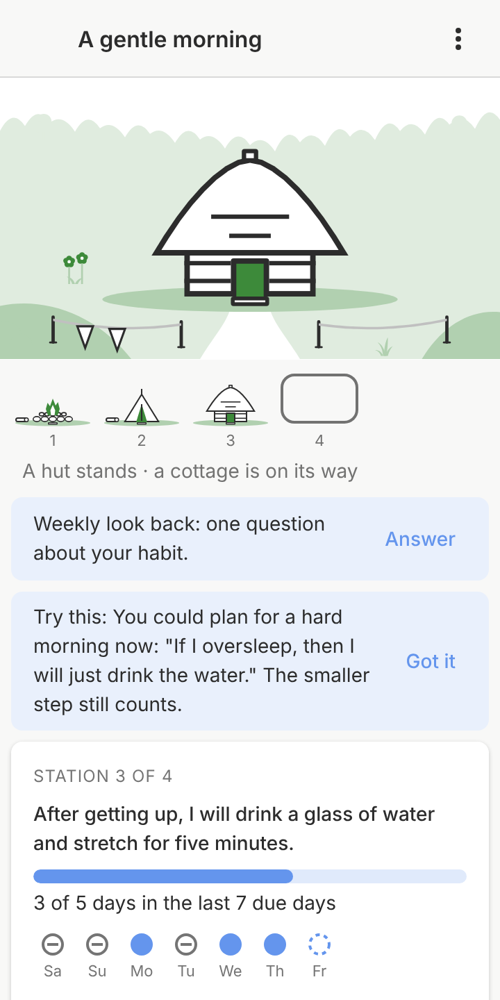
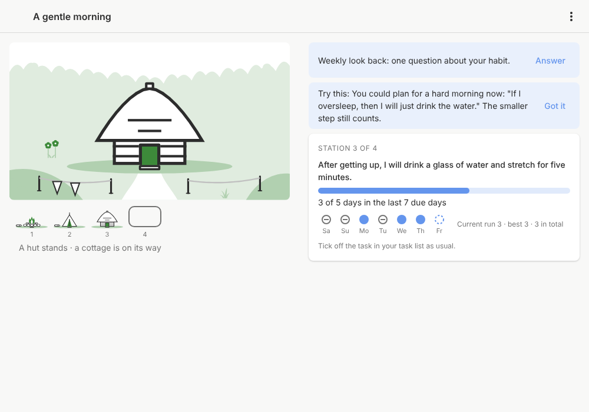
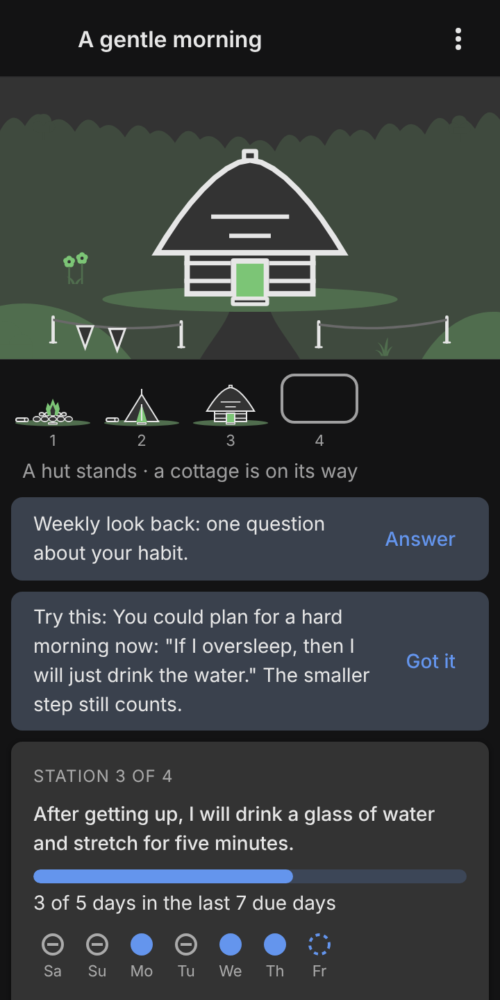
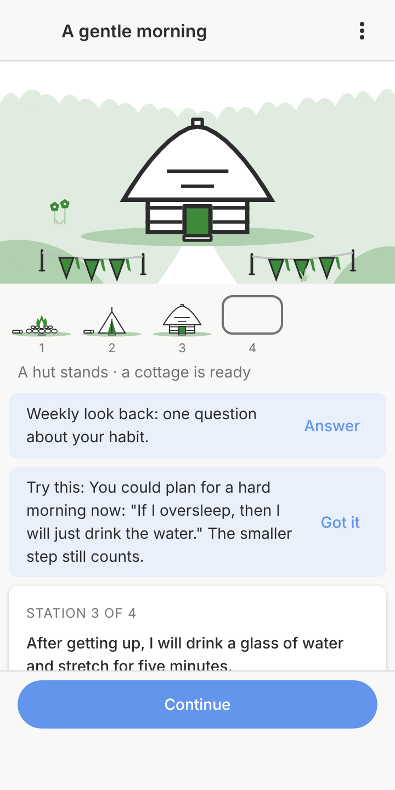
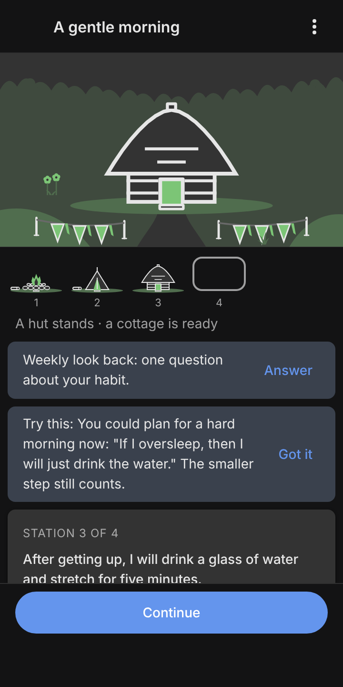
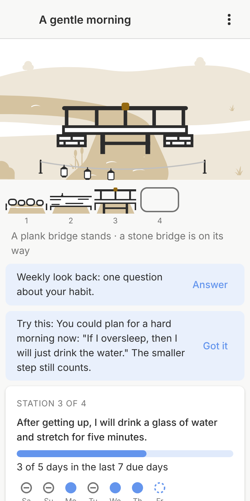
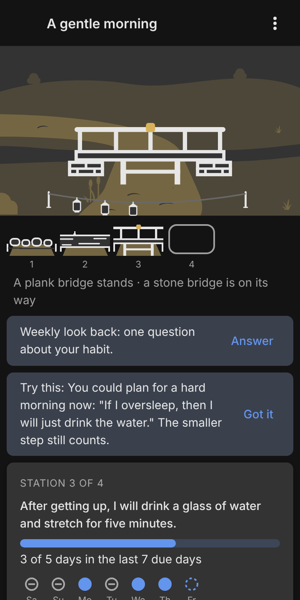
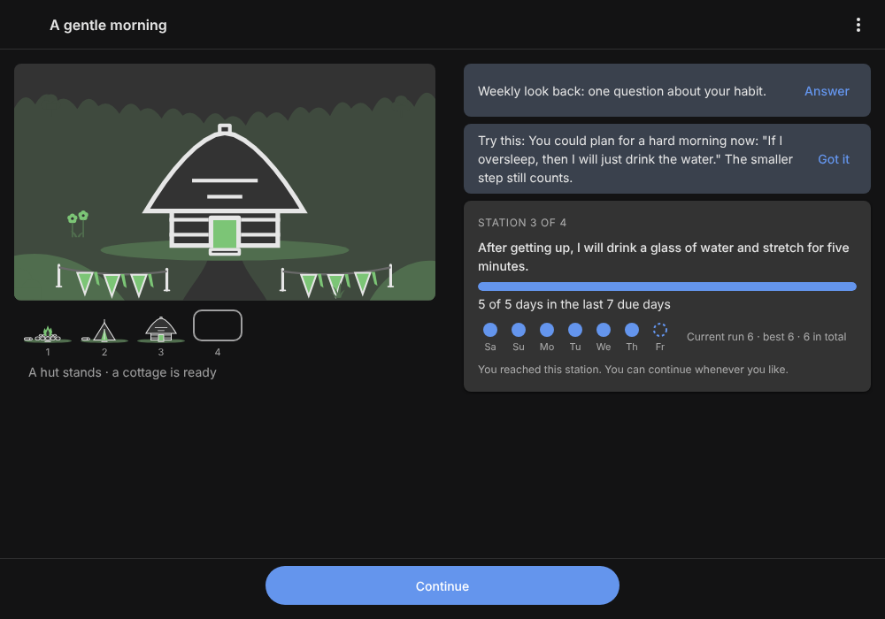

# Journey design

Decided on 2026-11-05 (#15) by best practice, as the owner asked, and
changed on 2026-11-13 (#110): there is one look. Every journey shows
what it builds; the drawn path with its stations, the calm and the game
variant, the level chip and the guardians are gone. The screens around
it are in [behaviour](behaviour.md).

## Layout

| Phone                                               | Desktop                                                 |
| --------------------------------------------------- | ------------------------------------------------------- |
|  |  |

- **Phone (360 px):** the build fills the upper part ([the journey
  screen with the build](#the-journey-screen-with-the-build)); the
  current station's card sits below it with the plan, the condition and
  the last seven due days.
- **Desktop and wide windows:** the build on the left, the card on the
  right.
- The stations are a list (**Stations** in the menu): number, name and
  state in words, each opening its details (plan, schedule, condition,
  learning nugget, arrival story).
- No map, no characters, no avatar to customise. The colours come from
  the host: in the plugin from Super Productivity's theme variables, in
  Pensum from libadwaita's accent and named colours, both in light and
  dark style.

## Last seven due days

A row of marks in the card, oldest left; the engine reports them as
`lastDays` of the current station ([data model](data-model.md) §3):

| Day        | Mark                                                                                   |
| ---------- | -------------------------------------------------------------------------------------- |
| done       | filled circle                                                                          |
| gap (miss) | hollow grey circle with a dash                                                         |
| open       | dashed ring (today, or yesterday not yet ticked off: still inside the backfill window) |
| not due    | not shown (only due days are listed)                                                   |
| paused     | two short bars                                                                         |

Weekday letters below each mark. A gap is grey, never red, and no count
falls to zero; the run text ("Run 4 · best 6") stays next to the marks.

## Accessibility

- Every state has a shape and a text, not only a colour.
- Touch targets at least 44 × 44 px.
- Texts follow the system font size; the card grows and scrolls.
- Screen readers get the build as one sentence and the stations as a
  list in journey order with their state.

## Builds and ladders (the Valley, #42)

Decided by the owner on 2026-11-12[^42]: a journey builds **one thing**,
whole at every stage, and every stage makes it a larger version. A
**ladder** is that thing drawn once in five versions and used by every
journey that picks it. The first two ladders, Crossing (with lanterns
and with pennants) and Home (with pennants and with flowers); plugin
light above, Day Planner dark below (scale 2). Each version, then its
marker growing element by element (every element for the first stage, a
few sampled steps for the others), ready, then the next version:

The journey screen as a static mock (plugin and Day Planner side by side;
Crossing above, Home below; first mid-way, posts up and two elements
hanging, then ready), light and dark: the build on top, the row of
versions below it, the state in words, the card unchanged.

| Light                                                          | Dark                                                         |
| -------------------------------------------------------------- | ------------------------------------------------------------ |
|  |  |

**Files.** A ladder is `content/art/<ladder>.ladder.json` with its title,
the default hue, whether its setting is water (`water`), its default
marker kind (`marker`), the marker's layout and post points (`layout`,
`posts`), where its setting has water (`waterAreas`), the versions (`build-<ladder>-<n>.svg`, each with a
title), optionally the part of every version the row of versions shows
(`row`), the way points (`ways`) and the setting with its places,
including the marker's; the setting is `setting-<kind>.svg`. Checked by
`ladderProblems` (`packages/engine/src/art-ladder-check.ts`) in
`npm run journeys`. The coordinates of both ladders come from
`scripts/draw-ladders.mjs`: change the numbers there and run it, never
edit the generated files by hand.

**Rules for drawing a ladder** (a new ladder comes by pull request like a
journey):

1. **Whole at every step.** Each version is a complete thing (a log, a
   plank bridge, a hut), never half built. Five versions; each clearly
   the same thing grown: same place, same footprint centre, larger.
2. **Same place, same setting.** Every version is drawn in the build's
   view box `0 0 120 80`, standing on y = 74, centred on x = 60, and
   placed in the same build slot of the setting (210 × 140 setting units,
   1.75 per build unit, base line on y = 140). Switching versions must
   read as the thing growing, not as a new picture.
3. **The way.** A build that carries the way (a crossing) has two fixed
   way points: its walking surface runs from x = 14 to x = 106 at
   y = 57–64 in every version, and the setting's path ends exactly there
   on both banks, as thick as the surface. A build the way leads to (a
   home) has one: the threshold stone (x = 53–67, y = 74–77.5) in front
   of the fire, the tent's opening and each door, where the path ends.
   `ways` lists them; the checker requires a corner of every version and
   of the setting's path at each way point.
4. **Water runs through.** Water in a setting runs from edge to edge (the
   river leaves the near edge and bends away to the left edge behind the
   crossing); it never stops in the middle of the scene. The shore's water
   also spans the whole width.
5. **Sizes.** Outlines 2 build units (3.5 px at 360 px, 1 px in the row of
   versions); every version must read at the journey screen's size (the
   setting 360 px wide) and in the row of versions at 60 × 40 px: give the
   smallest versions mass and a clear silhouette (stones with a flat top,
   a log as thick as two path widths), not thin lines. A ladder whose
   small versions are wide and flat may name `row`, a 3 : 2 part of the
   build's view box that the row shows zoomed (Crossing: `[30, 38, 60,
40]`, the stones without the bank slabs); the scene always shows the whole build. The largest version may
   reach y = 4; the setting's sky is at most its top fifth.
6. **Bank contact.** A crossing rests on the banks at both way points:
   stone abutments under the deck ends (stepping stones, log, plank
   bridge) or masonry reaching into the banks (stone and covered bridge).
   No deck floats.
7. **Growth in size and form.** Each version is larger than the one
   before and also different in form, so the row reads as a story: Home
   is a fire in a ring of single stones, a tent, a hut under a round
   thatch, a cottage with a pitched roof and chimney, a house of two
   storeys.
8. **Look.** Outlined in `fg` with a `bg` fill, one `accent` detail (the
   flame, a glowing door or window, the keystone, a rail cap), water and
   the yard in `tint-strong` of the region's hue. The setting is quiet:
   ground and far trees in `tint`, a few reused plants (tuft, reeds, bush,
   flowers, far trees) in the [depth bands](#look-and-depth-bands).

**Markers: a stage on its way** (owner, 2026-11-12; replacing the
scaffold, which looked like a permanent building site over a thing that
is meant to be whole, and later drafts with a ring around the build and
with fixed phases, which could not be read in order). While a stage runs,
a small festive **marker** grows in the foreground, in front of the
build, never on it, behind it or across it:

- **Element by element.** A marker has E elements in a fixed order: first
  the posts, one after the other, then the hanging elements, one after
  the other along the line from the first post. The line between two
  neighbouring posts shows once both stand. The hosts show the first
  ceil(p × E) elements, p (0 … 1) the best progress reached in the
  stage's condition; p = 1 means all stand. So a `days` stage (5 of 7)
  and a `count` stage (20) fill the same marker, and since p is the best
  progress, never the current one, the marker never loses an element.
- **Ready** while the condition is met now: every hanging element takes
  its "on" form, different in shape, not only in colour: lanterns filled,
  with a flame and rays; pennants solid with a second tail; flowers open
  instead of in bud. It reads without telling the accent apart.
- **Posts carry nothing on top.** They are plain (a post with a rounded
  top); everything decorative hangs from the line.
- After the last version nothing is on its way: no marker. On Continue
  the next version stands and the marker is gone until the next stage's
  first counting completion.

Counts stay where they are exact: the progress bar, the words ("3 of 5
days") and the seven day marks in the card. Under the row of versions
the state is said in words, never as a building site: "A plank bridge
stands · a stone bridge is on its way" while the stage runs, "… · a stone
bridge is ready" while it is met.

**Marker kinds** (`content/art/markers.json`), each drawn once and used
with every ladder and setting; what hangs is the user's choice per
journey, the ladder only gives the default (`marker`: Crossing lanterns,
Home pennants):

- **lanterns**: small lanterns, outlined; ready filled with a flame, a
  halo and rays.
- **pennants** (`bunting`): pale outlined pennants; ready solid in the
  accent with a second tail.
- **flowers**: vines with closed buds; ready open blossoms. Land only:
  the checker refuses flowers for a ladder whose setting is water
  (`"water": true`).

Each kind has three pictures (view box 32 × 32): `marker-<kind>-post`
stands on y = 30 and the line is tied on at (16, 15); `marker-<kind>-bead`
hangs from the line at (16, 2); `marker-<kind>-bead-lit` is its ready
form.

**Layouts and post points.** A setting declares its marker's layout and
an ordered list of post points in the near band, as it declares where the
path meets the build:

- `span`: one continuous line over all posts (at least two). For a
  setting where the line can run in front of the build without crossing
  the way or the view: Crossing, two posts on the near ground of each
  bank and one line across the water in front of the bridge, sagging
  gently.
- `sides`: two short lines, left and right, with a gap in the middle
  (four posts, two on each side). For a way leading to the build (Home:
  the path to the door) or a build on water (a boat: the gap is the
  waterway).
- **Choosing**: the gap is wherever the user's way or view to the build
  passes. If nothing passes in front of the build, `span`; otherwise
  `sides` with the gap there.
- **No post stands in water.** A setting with water marks it
  (`waterAreas`, polygons in setting units, in the ladder file); a post
  point inside one is refused. A line may cross water; a long line is
  drawn a little thicker and sags more (by its length), it never gets an
  extra post.

The lines are pictures of the setting (`setting-<kind>-cord-<n>.svg`, the
same for every kind); the hanging elements sit at fixed points along
them, spread evenly, in order from the first post (Crossing 2 posts and 6
elements, Home 4 posts and 6 elements). All numbers come from
`MARKER_LAYOUTS` in `scripts/draw-ladders.mjs`. Every marker place in the
ladder file has its `order` (1 … E); a line has the order of its second
post.

The checker (`ladderProblems`, `markerProblems`) requires: a known marker
kind with its three pictures and a title; flowers not on water; a layout
of `span` (at least two post points) or `sides` (four); post points in
the near band, left to right, none in a marked water area; one post on each point, in order, tied on below the
build's base line; one line per pair of neighbours (`sides`: none across
the gap), each shown with its second post; at least two hanging elements
after the posts, in order, each under a line and below the build; nothing
of the marker over a way point.

**A new marker kind** comes by pull request like a ladder: add it to
`MARKERS` in `scripts/draw-ladders.mjs` with its three pictures (a plain
post, the hanging element and its ready form, different in shape), set
`landOnly` if it needs ground, run the script, and show it with every
ladder in both hosts (`sequence-<ladder>-<kind>`) light and dark at
360 px. A new setting declares its layout and post points by the rule
above.

**Slots** in a ladder's setting, filled by the hosts: `build`, `lantern`
(after graduation, lit, where the marker's first post stood: the
marker's lasting form), `keeper` (reserved and not drawn: it was meant for a
worn-down guardian, and guardians are gone, #110) and the `marker` places above.

**Row of versions.** Below the build: the standing versions as small
pictures (60 × 40 px), the next one as a plain outlined step without a
picture, like stations ahead; nothing further is shown.

**Colour per region.** A region's scene takes `accent`, `tint` and
`tint-strong` from one hue of `content/art/palette.json` (eight named
hues, a light and a dark value each); `fg`, `bg` and `dim` stay the
host's, and the path, card and controls keep the host's accent. The
setting's kind sets the default (river: water blue; clearing: meadow
green). Each hue is checked by computation (WCAG relative luminance) in
both repositories: `accent` at least 3 : 1 against every host card (WCAG
1.4.11, non-text), `tint-strong` at least 1.5 : 1 (decorative, but the
water must show) and the outline `fg` at least 3 : 1 on `tint-strong`;
`tint` is decorative and not tested. Each ladder in two hues, plugin
light above, Day Planner dark below:

**Review rounds** (both hosts, light and dark, journey mock at 360 × 720;
rounds 1–4 still show the dropped pile or scaffold):
[1, crossing](screenshots/ladder-round-1-crossing.png) and
[home](screenshots/ladder-round-1-home.png): the build too small, the
river a straight wedge, beams like drawers;
[2](screenshots/ladder-round-2.png): larger slot (1.75), river bends at
the near edge, hut redrawn; [3](screenshots/ladder-round-3.png): river
behind a fold, wider pile columns (the pile was later dropped);
[4](screenshots/ladder-round-4.png): the owner's corrections: the path
meets the crossing and the door at fixed way points, the river runs edge
to edge, the scaffold and flag instead of a pile. Markers (both hosts,
journey mock light): [m1](screenshots/ladder-markers-round-1.png) a ring
of posts around the build: the abutments looked like boats, too many
lanterns, the flame a tree; [m2](screenshots/ladder-markers-round-2.png)
brick abutments, a rounded thatch for the hut, the row zoomed;
[m3](screenshots/ladder-markers-round-3.png) the owner could not read the
ring's steps in order (a line behind the build looked odd, ready was a
colour only): superseded by a gate across the path, then by the marker
that grows element by element; [m4](screenshots/ladder-markers-round-4.png)
element by element, `span` and `sides`: the posts looked like
stanchions, and the scenery flowers read as a hanging element;
[m5](screenshots/ladder-markers-round-5.png) slimmer posts, larger
elements; then the owner asked for plain posts with nothing on top and
ready only on the hanging elements; [m6](screenshots/ladder-markers-round-6.png) plain posts, but the `span` middle post stood in the water: now two posts, one on each bank, and one line across: the final images above.

## The journey screen with the build

Issue #100, for every journey since #110. The
engine's `build` view ([game rules](game-rules.md) §7) gives the ladder,
the version, the versions the journey uses, the marker kind, the hue,
the marker progress and whether the stage is ready; the screen draws it
with the ladder's scene of "Builds and ladders" above.

| Phone, light                                               | Phone, dark                                              |
| ---------------------------------------------------------- | -------------------------------------------------------- |
|  |  |

| Ready, light                                                                 | Ready, dark                                                                       |
| ---------------------------------------------------------------------------- | --------------------------------------------------------------------------------- |
|              |                     |
|  |  |

What you build on the start page (Change open) and from the menu, the
stations list and Settings with the side panel switch:
[start](screenshots/journey-build-start-change.png),
[what you build](screenshots/journey-build-build-page-2.png),
[stations](screenshots/journey-build-stations.png),
[settings](screenshots/journey-build-settings.png). In Super Productivity
20.0.0 (real-app test): [the first post after the first tick](screenshots/journey-build-real-app-first-post.png),
[ready, with the message's Show](screenshots/journey-build-real-app-ready.png),
[the next version after Continue](screenshots/journey-build-real-app-next-version.png),
[the side panel beside Today](screenshots/journey-build-real-app-side-panel.png).

- **Phone (360 px):** from the top, the build at the
  full width (the setting is 16 : 9, so 360 × 203 px), the row of
  versions, the line of state, then the card area.
  The upper part does not scroll; the card area does.
- **Desktop (720 px and wider):** the build with its row and line on the
  left, the card on the right, both from the top. The build is at most 560 px wide.
- **Row of versions:** the versions that stand as 60 × 40 px pictures
  with their number under them, the next as a plain rounded step with its
  number, nothing beyond. A journey uses `versions` = stages + 1; when a
  ladder has fewer pictures than that, the last picture stands for the
  versions after it (the checker warns about such journeys).
- **Line of state:** the version's name and what is on its way, from the
  journey's own names (`build.names`) where given, else the ladder's
  titles. Before the stage's first counting completion only "A hut
  stands"; after the last stage only what stands.
- **For screen readers** the picture's label is the same in words with
  the marker counted: "A plank bridge, version 3 of 5; marker: 2 of 2
  posts and 3 of 6 lanterns; not ready yet" (or "ready", or "nothing on
  its way yet"). The row is a list ("Versions: 1, 2 and 3 stand; 4 is
  next"). The marker's counts in the label are the only place where
  elements are counted; the card keeps the exact stage counts.
- **The moment of the tick:** the screen remembers, for as long as it is
  open, which run, version and number of elements it last drew. When a
  redraw shows more elements, the new ones grow in (scale from 0.6 and
  fade, 600 ms, ease-out, from their foot); a new version fades in the
  same way. Under `prefers-reduced-motion: reduce` nothing moves. The
  first draw after opening animates nothing.
- **Station details** are in the menu (**Stations**) as a list in
  journey order.
- **Side panel:** with the setting on, the same page is in Super
  Productivity's right panel beside the task list. The panel is narrow,
  so it shows the phone layout with the build on top: the build is in
  view while ticking off ([facts](super-productivity-facts.md) §7: a
  plugin cannot draw anywhere smaller or closer to the task list).
- **Bundle:** the plugin carries only what this screen and the start
  page draw: per ladder its setting, the lines of the marker, the
  versions; the three pictures of each marker kind; the lantern; the
  palette. Pictures no screen draws yet stay preview-only
  (`ladderArt` in `packages/plugin/art.mjs`, checked by a test). They
  travel in `plugin.js` and reach the view once at start (message
  `questarc:art`); until they arrive the screen shows only the card. The
  view's `index.html` is limited to 102,400 bytes by Super Productivity
  19.3.1, and the view may load no other file of the plugin
  ([facts](super-productivity-facts.md) §1), so the view also takes the
  journeys' texts from each state instead of bundling the journeys.
  Measured on 2026-11-12: `index.html` 86,390 of 102,400 bytes (15.6 %
  free; with the pictures inlined it was 112 KB even fully minified);
  the ZIP 40,009 bytes on `main` with #103, 51,203 bytes with the build.
- **Picture polish** with the build at its real size (issue #100's
  review): lit lanterns get an opaque halo in `tint-strong` larger than
  the lantern, so they glow in light style too; open blossoms are white
  (`bg`) with an accent centre instead of green on green, buds white
  with an accent tip; the line between posts is `dim` and thinner and
  the posts shorter (tied on at y = 15), so the first steps no longer
  read as a rope fence; the fire has a light core. The pennants' ready
  form is unchanged (the solid fill carries it).

## Look and depth bands

Art direction from #97[^97], kept by the ladders' settings. The region
scenes it was first drawn for (landmarks beside a path, a meadow and a
shore) were replaced by [builds and ladders](#builds-and-ladders-the-valley-42)
and are removed; they are in git history up to version 3.1.0.

**Look.** Calm and light: built things are outlined in `fg` and filled
with `bg`, with at most one `accent` detail; nothing built is solid.
Growth (tufts, flowers, bushes, trees, reeds) is solid `tint-strong`,
with `accent` only for blossoms. Ground and distance use `tint` and
`tint-strong` only; the sky is the card itself.

**Three depth bands**, each with fixed sizes (a picture is square; its
feet are on y = 30 of its 32 grid, so feet = y + 15/16 of its size). In
a setting (320 × 180) the feet stand:

| Band   | Feet between | Large (tree) | Medium (bush, lantern, reeds) | Small (tuft, flowers) | Drawn as                 |
| ------ | ------------ | ------------ | ----------------------------- | --------------------- | ------------------------ |
| far    | 36–80        | 20           | 12                            | –                     | one silhouette in `tint` |
| middle | 80–145       | 34           | 24                            | 14                    | own roles                |
| near   | 145–180      | 48           | 34                            | 20                    | own roles                |

At most the top fifth is empty sky. The far band holds only scenery: it
merges with the ground into one light silhouette, so it never competes
with what was built. Pictures are listed back to front (feet never move
up), so nearer things cover farther ones. The sizes are `BAND_SIZES` in
`packages/engine/src/art-bands.ts`, the feet `SETTING_FEET` in
`art-ladder-check.ts`.

**Smallest sizes.** Every single picture must read at 24, 32 and 48 px
on a card (preview part `sizes`, [development](development.md)).
